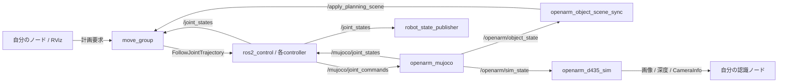

# OpenArm_sim

**OpenArm 1.0 / 2.0と、3輪オムニ台車を搭載したHappy mignonを、ROS 2・MoveIt 2・MuJoCoで動かすDocker開発環境です。**

Ubuntu 24.04向けのセットアップ、物体配置GUI、RGB-Dカメラ、双腕把持デモ、コンテナに接続するVS Code開発環境をまとめています。**Happy mignon（モード3）** では、生活環境エディター・台車走行・SLAM・Nav2も使用できます。初めて使う方は[モード3の使用ガイド](#mignon)へ進んでください。

| 構成 | 内容 |
|---|---|
| ロボット | モード1：OpenArm 1.0／モード2：OpenArm 2.0／モード3：Happy mignon |
| ソフトウェア | Ubuntu 24.04・ROS 2 Jazzy・MoveIt 2・MuJoCo |
| 描画 | GPUを検査して選択。利用できない場合はCPU描画 |
| 物理計算 | CPUで実行 |
| 物体 | 直方体・500 mLボトル・YCBライブラリ103項目 |
| カメラ | 胸部RGB-D、2.0の左右手内RGB。モード3は胸部D435i・台車D455のRGB-Dにも対応 |
| 移動・地図（モード3） | 3輪オムニ台車、2D LiDAR、SLAM Toolbox、Nav2、任意装着のMID-360S |

## OPL 2026 の物体・家具

シーンGUIの **「OPL 2026 物体・家具を開く」** から、Category A の34項目と公開家具14種を選択できます（OpenArm 1.0 / 2.0 共通）。
家具を配置して支持面を選ぶと、物体の高さを自動調整します。衝突・支持面外・物体を載せたままの家具移動／非表示は拒否します。
既存YCBを15項目に再利用し、残りは寸法・質量を仮定した剛体近似です。大会環境の完全再現や、布・液体・家電動作を意味しません。
[出典、近似の制限、操作例](docker/OPL_2026.md) を参照してください。

## 目次

- [はじめに：起動する](#quick-start)
- [Happy mignon モード（モード3）の使い方](#mignon)
- [GUIで操作する](#gui)
- [よく使うコマンド](#commands)
- [VS Codeで開発する](#development)
- [把持デモを実行する](#demos)
- [起動オプション・オフライン利用](#startup-options)
- [ROS 2開発ガイドとAPI一覧](#ros-development-guide)
- [モーター・関節と制御先](#motor-api)
- [全カメラのトピック・サービス・TF](#ros-camera)
- [困ったとき](#ros-troubleshooting)
- [関連資料・ライセンス](#documents)

<a id="quick-start"></a>
## はじめに：起動する

### 必要な環境

Ubuntu 24.04 **amd64（x86_64）**が対象です。Ubuntuの仮想マシンと、RTX 3060 Ti搭載のUbuntu機で検証しています。初回はインターネット接続とsudo権限が必要です。

不足するPython・venv・Git・Docker・Compose・ホスト側VS Code・Dev Containers拡張は起動スクリプトが導入します。利用可能な既存Dockerは置き換えません。Gitがまだない場合は、GitHubの **Code → Download ZIP** から取得・展開できます。

### 1. リポジトリのフォルダーを開く

**実行場所：ホストUbuntuの端末。** 以下はホーム直下に配置した場合です。別の場所へ展開した場合は、そのフォルダーに移動してください。

```bash
cd ~/OpenArm_sim
```

### 2. 起動する

```bash
/usr/bin/bash start.sh
```

環境チェック後に、画面の案内に従って **1（OpenArm 1.0）**、**2（OpenArm 2.0）**、**3（Happy mignon）** から選びます。初回は依存関係のダウンロードとDockerイメージのビルドに時間がかかります。2回目以降は、ソースが変わらなければ既存イメージを再利用します。

### 3. 起動完了を確認する

次の表示が出たら、腕・グリッパーの制御系の準備が完了です。モード3では、さらに[地図とナビゲーションの状態](#mignon-navigation)を確認します。

```text
All 5 ROS controllers active; simulation ready
```

| 起動した環境 | 表示先 |
|---|---|
| 利用可能なX11 / XWaylandセッションがあるDesktop | ホスト上にRViz・MuJoCo・シーンGUIを表示 |
| GUIセッションがないServer / SSH接続 | ブラウザー表示 |

ブラウザー表示の場合は、Ubuntu機のブラウザーで [シミュレーション画面を開く](http://localhost:6080/vnc.html?autoconnect=true&resize=scale)。別PCの`localhost`はUbuntu機を指しません。

### 4. 短いコマンドを現在の端末にも読み込む

起動時にシェルコマンドが登録されます。すでに開いていた端末では、一度だけ次を実行します。

```bash
source ~/.bashrc
```

以降は[よく使うコマンド](#commands)から操作できます。子プロセスの起動スクリプトから、親ターミナルの関数を直接変更することはできません。

<a id="mignon"></a>
## Happy mignon モード（モード3）の使い方

**OpenArm 2.0・3輪オムニ台車・センサー・地図作成・Nav2をまとめて使用するモードです。** 腕単体のモード1・2とは開発ワークスペースが分かれています。初めて使う場合は、次の順で進めてください。

**モード3で起動 → 部屋を作成・適用 → 手動で走行して地図作成 → 地図を保存 → 保存地図で起動 → Nav2で移動**

- [起動と画面の見分け方](#mignon-start)
- [生活環境を作成・保存・切替](#mignon-room)
- [台車と腕を操作](#mignon-controls)
- [マップ作成からナビゲーション](#mignon-navigation)
- [カメラ・3D LiDARを表示](#mignon-sensors)
- [VS Codeで開発・パラメーター調整](#mignon-development)
- [主なROS 2インターフェース](#mignon-ros)
- [困ったときの確認](#mignon-help)

<a id="mignon-start"></a>
### 起動と画面の見分け方

**実行場所：ホストUbuntuの端末。** ホーム直下にクローンした場合：

```bash
cd ~/OpenArm_sim
bash start.sh --robot-version 3
```

引数なしで起動した場合は、環境チェック後の機体選択で **3: Happy mignon** を選びます。初回は専用イメージのビルドと、ロボットPC用ワークスペースの初期ビルドを行います。すでに開いていた端末で `oa` などが使えない場合は、次を一度実行してください。

```bash
source ~/.bashrc
```

| 画面 | 用途・見分け方 |
|---|---|
| MuJoCo | 機体、部屋、物体の物理シミュレーションを表示 |
| シミュレーション用RViz | **MotionPlanning** で腕を操作。配置した家具・物体も表示 |
| センサー・運用用RViz | **Navigation 2** パネルがある画面。機体、センサー点群、観測した地図、経路を表示 |
| シーンとセンサー | 手動走行、腕の姿勢、カメラ・LiDAR配信、地図保存、再起動を操作 |
| 生活環境エディター | シーンパネルの **生活環境エディターを開く** から別ウィンドウで開く |

Desktopではホスト上にウィンドウを表示します。GUIセッションがない場合はブラウザー表示になり、接続先が起動ログに表示されます。[共通の起動手順](#quick-start)も参照してください。

`All 5 ROS controllers active; simulation ready` は腕・グリッパーの制御準備が完了した表示です。**地図作成やNav2の準備完了を意味する表示ではありません。** 運用用RVizとシーンパネルで地図・動作モードを確認します。

<a id="mignon-room"></a>
### 生活環境を作成・保存・切替

1. **生活環境エディターを開く** を押します。
2. 配置ツールから **壁・机・椅子・収納棚** を選び、平面図をクリックします。
3. **選択・移動** で家具をドラッグするか、右欄で中心座標・向き・寸法を入力して **数値を反映** を押します。距離はm、角度は度です。平面図は右が+X、上が+Yです。
4. **環境を保存** で名前を付けます。例：`大会A_予選`、`大会A_決勝`。
5. **部屋を適用して再起動** を押します。台車と腕が初期状態に戻り、作成した部屋がシミュレーションに反映されます。

破線の円は機体の初期位置です。家具がこの領域に重なる配置は拒否されます。最初のマップ作成では、2D LiDARで観測できる壁などを配置してください。

**机の上に物体を置く場合：** 机を選択 → **机の上を編集…** → ボトル・直方体・飲料缶を選択 → 天板をクリックして配置 → **机に反映** → 部屋を保存・適用します。ドラッグや数値指定で位置を調整でき、同じ種類を複数置けます。適用後は物体に重力と衝突が働きます。モード1・2の把持対象配置GUIは、モード3では使いません。

| ボタン | 動作 |
|---|---|
| 新規 | 新しい部屋の編集を始める |
| 環境を保存 | 編集中の部屋を名前付きでライブラリに保存 |
| 編集用に開く | 保存した部屋を編集画面に読み込む。走行中の部屋は変えない |
| この環境に切替 | 一覧で選んだ保存済みの部屋を適用し、機体を再起動 |
| 部屋を適用して再起動 | 編集中の配置をシミュレーションへ反映 |
| 環境を削除… | 確認後、ライブラリの保存版を削除。使用中の部屋・作成済みのNav2地図は保持 |
| 書き出し／ファイル取込 | 部屋のJSONを受け渡す |

**部屋の保存とNav2の地図保存は別です。** 部屋は家具・机上物体の配置、Nav2の地図は2D LiDARで観測した占有格子地図です。部屋を保存しただけでは走行用地図は作成されません。適用中の部屋と名前付きの保存版はコンテナ再作成後も残ります。

<a id="mignon-controls"></a>
### 台車と腕を操作

シーンパネルの **台車の手動運転** で速度を選び、**ユーザー移動制御モード** をオンにします。緑色の操作欄にキーボードフォーカスがある間、次のキーを使えます。

| キー | 動作 |
|---|---|
| W / S | 前進 / 後退 |
| A / D | 左へ平行移動 / 右へ平行移動 |
| Q / E | 左旋回 / 右旋回 |
| Esc | 手動モードを解除 |

前方は **UTM-30LX（2D LiDAR）がある側、車体座標の+X** です。移動キーを離すと減速して止まります。操作欄からフォーカスが外れた場合やチェックを外した場合も手動モードを解除します。

| 手動速度 | 並進 | 旋回 |
|---|---:|---:|
| 低速 | 0.18 m/s | 0.5 rad/s |
| 標準 | 0.40 m/s | 0.9 rad/s |
| 高速 | 0.60 m/s | 1.2 rad/s |

**Nav2や自作コードで走行させる前に手動モードを解除してください。** 手動モード中はキーを押していなくても手動指令が優先され、通常の `/cmd_vel` は受け付けません。解除後、最後の手動指令から約0.5秒で通常指令を受け付けます。速度選択は手動運転だけに適用され、Nav2の速度は設定ファイルで調整します。

腕の姿勢を変えるときは台車を停止し、シーンパネルの **アーム姿勢（MoveIt 2・関節角度）** を使います。

1. `right` または `left` を選び、**現在角を取得** を押します。
2. J1〜J7を度単位で編集し、**計画して実行** を押します。
3. 中断する場合は **中止** を押します。

**初期姿勢を入力** は入力欄を0度にするボタンです。実際の移動には **計画して実行** が必要です。手先をドラッグする場合は、シミュレーション用RVizの[腕の操作手順](#gui)を使います。

<a id="mignon-navigation"></a>
### マップ作成からナビゲーション

#### 1. マッピングの状態を確認する

その部屋で保存地図をまだ選択していない場合は、**SLAM Toolboxによるマッピング** で起動します。シーンパネルの **地図作成・Nav2** の下に、`マッピング: 手動運転で走行し、地図を保存してください。` と表示されます。以前の選択は部屋の配置ごとに復元されます。

壁などを配置した部屋を適用し、手動運転で周囲を観測します。センサー・運用用RVizの **Sensor map** に地図が広がることを確認してください。特徴のない空の部屋では地図作成が安定しない場合があります。

**マッピングとNav2の未起動は区別してください。** この構成ではマッピング中もNav2を起動しますが、保存地図を使うAMCLは起動しません。`Localization` の表示だけでNav2の起動失敗とは判断しないでください。初めての利用では、以下の手順で地図を保存してから自律走行へ進むと状態を確認しやすくなります。

#### 2. 地図を保存する

1. 手動走行を停止します。
2. **地図作成・Nav2** に地図名を入力します。例：`room_01`。
3. **地図を保存** を押し、`地図を保存しました` と表示されるまで待ちます。

地図名は1〜64文字の文字・数字・ハイフン・下線を使います。同じ部屋での同名保存は上書きされないため、再保存には別名を付けてください。

#### 3. 保存地図で起動し、自己位置を確認する

1. 地図名の一覧から使用する地図を選び、**保存地図で起動** を押します。
2. 再起動の確認に進みます。機体は初期位置に戻り、地図サーバーとAMCLが起動します。未保存の作成途中の地図は失われます。
3. パネルが `自己位置推定: <地図名>` になり、運用用RVizに保存地図が表示されることを確認します。
4. 機体の表示位置や向きが地図と合わない場合は、RVizの **2D Pose Estimate** で正しい位置から向きに沿ってドラッグします。**UTM-30LX** のスキャンと地図上の壁が重なるか確認してください。

地図操作は **Views → Map 2D** をダブルクリックすると行いやすくなります。**Robot 3D** で機体中心の3D視点へ戻せます。3D表示では **Move Camera** を選んで左ドラッグすると、周囲360°と上下の視点を変更できます。

#### 4. Nav2で目的地へ移動する

1. **ユーザー移動制御モードをオフ** にします。
2. 運用用RVizの **Nav2 Goal** を選び、走行できる地図上の目的地から、到着時に向けたい方向へドラッグします。
3. **Global plan** の経路と機体の移動を確認します。中断するときは **Navigation 2** パネルでキャンセルします。

標準設定は最大0.40 m/s・0.9 rad/sです。自律走行では2D LiDAR側を前に向けて進み、横・後方への経路では必要に応じて先に旋回します。手動運転の左右平行移動とは動作が異なります。

**新規マッピング** を押すと、確認と再起動を経て地図作成へ戻ります。保存済みの地図は保持されます。家具配置を変えた場合は、その配置に対応する地図を新しく作成してください。地図の一覧には現在の部屋に対応したものが表示されます。机上の小物だけの変更では同じ地図を使用できます。

<a id="mignon-sensors"></a>
### カメラ・3D LiDARを表示

| センサー | 開始方法 | 運用用RVizでの表示 |
|---|---|---|
| UTM-30LX相当の2D LiDAR | モード3の起動時に配信 | **UTM-30LX**。`/scan` がSLAM・Nav2への観測入力 |
| 胸部D435i・台車D455・左右手内RGB | **カメラ配信 → 配信開始** | RGB-D点群は **Chest D435i RGB-D** / **Chassis D455 RGB-D** を有効化。画像は **Add → Image** でトピックを選択 |
| MID-360S 3D LiDAR（任意） | **MID-360S 点群 → 配信開始** | **MID-360S 3D LiDAR**。未装着なら自動で取り付け・再起動後に配信 |

カメラは初期OFF・既定2 fpsです。胸部と台車の点群は購読されると生成されます。手内カメラはRGBのみで、D435iのIMUデータは再現していません。

MID-360Sは通常起動時に未装着です。**配信停止** は点群の停止、**取り外す** は筐体・ブラケットの取り外しと再起動です。運用用RVizでは `/lidar/points` を直近1秒分表示し、**Displays → MID-360S 3D LiDAR → Decay Time** で表示の蓄積時間を変更できます（0で最新の1回分）。**点群密度** はシーンパネルから変更できます。

**現在のNav2設定は2D LiDARの `/scan` を使用します。** 3D LiDARやカメラの点群を表示しただけでは、Nav2の障害物入力には追加されません。センサー用RVizに部屋の家具メッシュが表示されないのも想定どおりで、観測できたスキャン・点群・地図で形状を確認します。

<a id="mignon-development"></a>
### VS Codeで開発・パラメーター調整

シミュレーション起動後、**ホストUbuntuの端末**で実行します。

```bash
oa-code
```

VS Codeがコンテナ内の一般ユーザーに接続し、`/workspaces/OpenArm_dev` を開きます。ターミナルだけを使う場合は、ホストで次を実行します。

```bash
oa
```

```text
/workspaces/OpenArm_dev/
├── external_ws/src/urg_node/       実機UTM-30LX用の既製ドライバー
├── happy_ws/src/main/
│   ├── happy_robot/               状態確認ノード
│   ├── happy_posture/             MoveIt 2による腕の姿勢制御
│   ├── openarm_demos/             OpenArmデモのソース
│   └── <各自のROS 2パッケージ>/    音声・認識・制御など
├── rooms/                        保存した部屋と適用中の配置
├── navigation/                   SLAM・Nav2設定と保存地図
└── recordings/                   GUIから保存した記録
```

シミュレーションでは `/scan` をMuJoCoが生成するため、実機用の `urg_node` を重ねて起動する必要はありません。自作パッケージは **`happy_ws/src/main/各自のパッケージ`** に作成またはクローンします。デモは腕単体向けのものも含むため、モード3の任意の部屋での把持成功を保証するものではありません。

**実行場所：`oa` またはVS Codeのコンテナ内ターミナル。** 新規・変更したパッケージをビルドし、その端末に反映します。

```bash
cd /workspaces/OpenArm_dev/happy_ws
colcon build --symlink-install
source install/setup.bash
```

状態確認（台車や腕を動かしません）：

```bash
ros2 run happy_robot robot_status
```

腕・オドメトリ・レーザーを受信すると `Received: arm, odom, scan` と表示されます。`external_ws` にパッケージを追加した場合は、先にそのワークスペースでビルド・sourceを行ってから `happy_ws` をビルドしてください。

| 編集・保存先（コンテナ内） | 内容 |
|---|---|
| `/workspaces/OpenArm_dev/navigation/nav2.yaml` | Nav2の速度、制御、AMCL、コストマップ等 |
| `/workspaces/OpenArm_dev/navigation/slam.yaml` | SLAM Toolboxの地図解像度・更新条件等 |
| `/workspaces/OpenArm_dev/navigation/by_room/<配置ID>/maps/<地図名>/` | `map.yaml` と地図画像。古い構成では `navigation/maps/` |
| `/workspaces/OpenArm_sim/` | 配布リポジトリ本体。Dockerやシミュレーション基盤のソース |

Nav2・SLAMの設定変更は保存後にシーンパネルの **シミュレーションを再起動** で反映します。台車と腕は初期状態へ戻るため、作成中の地図は先に保存してください。通常の自作ROSパッケージはワークスペースでビルドし、`docker/app/` などイメージ内の環境本体を変更した場合はホストでモード3を再起動して再ビルドします。

```bash
bash start.sh --robot-version 3 --rebuild
```

開発ファイルと設定の実体は、**ホストのリポジトリ配下 `.openarm/happy_robot_pc/`** に保存されます。コンテナの再作成で消えませんが、配布リポジトリへのpushで自動共有される場所ではありません。チームのコードは各自のGitで管理し、部屋と地図を移すときは `rooms/` と `navigation/` を一緒にコピーしてください。

Nav2の初期設定では機体の平面形状を半径0.30 mの円で近似しています。**腕を伸ばした形状を自動でナビゲーションの占有範囲に反映する設定ではありません。** 運用する姿勢に合わせてコストマップの形状や余裕を調整してください。

<a id="mignon-ros"></a>
### 主なROS 2インターフェース

| 名前 | 種類・型 | 用途 |
|---|---|---|
| `/cmd_vel` | Topic / `geometry_msgs/msg/Twist` | 通常の台車指令。`linear.x` 前後、`linear.y` 左右（m/s）、`angular.z` 旋回（rad/s） |
| `/happy/manual_cmd_vel` | Topic / `geometry_msgs/msg/Twist` | GUIの優先手動指令 |
| `/odom` | Topic / `nav_msgs/msg/Odometry` | シミュレーションの車体姿勢・速度 |
| `/scan` | Topic / `sensor_msgs/msg/LaserScan` | UTM-30LX相当。`laser` フレーム、270°、1081点 |
| `/map` | Topic / `nav_msgs/msg/OccupancyGrid` | SLAMまたは地図サーバーの2D地図 |
| `/plan` | Topic / `nav_msgs/msg/Path` | Nav2の大域経路 |
| `/initialpose` | Topic / `geometry_msgs/msg/PoseWithCovarianceStamped` | 保存地図で使用するAMCLの初期姿勢 |
| `/navigate_to_pose` | Action / `nav2_msgs/action/NavigateToPose` | Nav2への目的地指示・結果・キャンセル |
| `/joint_states` | Topic / `sensor_msgs/msg/JointState` | 腕・グリッパー等の関節状態 |
| `/right_arm_controller/follow_joint_trajectory`、`/left_arm_controller/follow_joint_trajectory` | Action / `control_msgs/action/FollowJointTrajectory` | 左右の腕の軌道実行。関節名は[関節一覧](#motor-api)を参照 |
| `/right_gripper_controller/follow_joint_trajectory`、`/left_gripper_controller/follow_joint_trajectory` | Action / `control_msgs/action/FollowJointTrajectory` | 左右グリッパーの軌道実行 |
| `/lidar/points` | Topic / `sensor_msgs/msg/PointCloud2` | MID-360Sの3D点群 |
| `/openarm/camera/set_enabled` | Service / `std_srvs/srv/SetBool` | カメラ配信の一括ON/OFF |
| `/openarm/camera/status` | Service / `std_srvs/srv/Trigger` | カメラの配信状態・エラーを取得 |
| `/openarm/lidar/set_enabled` | Service / `std_srvs/srv/SetBool` | **装着済み**LiDARの配信ON/OFF。未装着からの取り付けにはGUIの配信開始を使用 |
| `/openarm/lidar/status` | Service / `std_srvs/srv/Trigger` | LiDARの装着・配信状態・エラーを取得 |
| `/clock`、`/tf`、`/tf_static` | Topic / シミュレーション時刻・座標変換 | 自作ノードは必要に応じて `use_sim_time:=true` を指定。走行時のTFは `map → odom → base_link` |

胸部は **`/camera/d435i`**、台車は **`/camera/d455`** を先頭に付けます。例：胸部RGB画像は `/camera/d435i/color/image_raw` です。

| 末尾 | 型 | 内容 |
|---|---|---|
| `/color/image_raw` | `sensor_msgs/msg/Image` | RGB画像（`rgb8`） |
| `/depth/image_rect_raw` | `sensor_msgs/msg/Image` | 深度（`16UC1`、mm、無効値0） |
| `/aligned_depth_to_color/image_raw` | `sensor_msgs/msg/Image` | RGB視点に整列した深度 |
| `/color/camera_info`、`/depth/camera_info`、`/aligned_depth_to_color/camera_info` | `sensor_msgs/msg/CameraInfo` | 対応する画像の内部パラメーター |
| `/depth/color/points` | `sensor_msgs/msg/PointCloud2` | 色付きXYZRGB点群（m、無効点NaN） |

左右手内のRGBは `/camera/left_wrist/color/image_raw` と `/camera/right_wrist/color/image_raw`、対応する内部パラメーターはそれぞれ末尾の `image_raw` を `camera_info` に置き換えたトピックです。センサーデータを購読する自作ノードでは、Best Effortに対応するSensor Data QoSを使用してください。

<a id="mignon-help"></a>
### 困ったときの確認

| 症状 | 確認すること |
|---|---|
| 地図がない／Localizationが準備できていない | パネルがマッピング中か自己位置推定中かを確認。マッピングなら壁を観測して地図を保存し、保存地図で起動する |
| 目標を指定しても進まない | 手動モードを解除し、機体位置と地図・スキャンの一致、目標位置の障害物、Navigation 2の状態を確認 |
| 点群が表示されない | 配信ONとDisplaysのチェックを確認。`map` のTFがまだなければFixed Frameを一時的に `odom` にして観測を確認。Nav2の位置・目標指定時は `map` に戻す |
| 家具を編集したのに変わらない | 保存だけでなく **部屋を適用して再起動** を行う |
| 保存した地図が一覧にない | 現在の家具配置に対応した地図か確認。別の部屋の地図は一覧から除かれる |
| キー操作が効かない | 手動モードがONで緑色の操作欄にフォーカスがあるか確認 |

**ホストUbuntu**から状態を確認するコマンドです。

```bash
oa-ros run happy_robot robot_status
```

```bash
oa-ros lifecycle get /controller_server
oa-ros lifecycle get /planner_server
oa-ros action list -t
```

Nav2の各サーバーは `active` が動作中の状態です。アクション一覧に `/navigate_to_pose` があることだけで、目的地へ移動できるとは限りません。地図・TF・自己位置も合わせて確認します。

ログを見る場合（ホストのリポジトリ内。Ctrl+Cでログ表示だけを終了）：

```bash
bash start.sh --logs
```

終了する場合：

```bash
bash start.sh --stop
```

GUIの **rosbag2記録** は既定の関節・TF・胸部画像などの記録です。`/scan`・`/odom`・D455・3D LiDAR・走行指令を含むモード3全体の記録ではありません。詳細は[記録機能](#gui-recording)と[ロボットPCの詳細](docker/mobile/ROBOT_PC.md)を参照してください。

<a id="gui"></a>
## GUIで操作する

### 物体・作業台・カメラ

| やりたいこと | 操作 |
|---|---|
| 作業台を表示する | シーンGUIの作業台切替を使う |
| 直方体・ボトルを置く | 物体を選び、配置する |
| 位置を指定する | 「位置を指定して配置」でX・Y・向きを入力し、「指定位置へ配置」を押す |
| マグカップ・皿などを置く | 「YCB オブジェクトライブラリを開く」で検索・配置する |
| カメラ画像を配信する | D435配信をONにする（初期状態はOFF） |
| 初期状態へ戻す | 「シミュレーションを再起動」を押す |

配置の単位は**X・Yがm、向きが度**です。world座標でXは前方、Yは左方向。高さは机上に自動調整されます。「手前・左」「手前・右」は入力値のプリセットなので、選択後に配置ボタンを押してください。

**モード3（機体全体）** では「生活環境エディターを開く」から机を選び、「机の上を編集…」でボトル・直方体・飲料缶を配置します。「机に反映」後に部屋を保存し、「部屋を適用して再起動」で走行環境に反映します。 保存した部屋を一覧から削除するには、環境ライブラリで部屋名を選び「環境を削除…」を押します。

**モード1・2** では物体を配置すると作業台も有効になります。作業台を消す前に、把持対象をすべて削除してください。腕を止めてから配置を変更します。机外や他の物体・アームと重なる配置は拒否され、元の位置が保たれます。プリセットは把持成功を保証する位置ではありません。

YCBは両モデル共通で、公式スキャン93項目・修復した近似2項目・代替形状8項目を含みます。マグカップ・平皿・ボウルも利用できます。[形状・力学上の制限](docker/YCB.md)を参照してください。

### 支柱と物体の表示・同期

1.0/2.0の支柱は銀色で表示します。支持部・支柱・D435を表示専用の固定リンクに分けて材質を適用しています。支持構造、衝突形状、質量・慣性、カメラ取付位置は維持しています。

RVizの **Physical objects (MuJoCo)** は物理シミュレーション内の実物位置です。**MotionPlanning** の計画シーンは半透明で、追加した独自の障害物も表示します。把持時のattached collision objectはMoveItが手に固定した論理形状で、実物表示とは別です。同期ノードはattached物体を世界物体として二重追加しません。

物体状態は10 Hz（シミュレーション時間）の小さい専用トピックで配信し、カメラ用sim_stateは5 Hz、画像は既定2 fpsのままです。MoveItへの更新は成功応答後に記録し、0.5秒ごとに実際の計画シーンを読み戻します。MoveIt再起動、追加・削除の取りこぼし、古い位置から最新状態へ回復します。起動が遅れたRVizも最新の実物表示を受け取れます。実時間の遅延はシミュレーション速度と描画負荷に依存します。

更新頻度の確認（**起動中コンテナ内のターミナル**）：

```bash
ros2 topic hz /openarm/object_state
```

再現可能な隔離回帰手順は [描画・同期の検証](tests/RENDER_SYNC.md) を参照してください。

### RVizで腕を動かす

1. ツールバーで **Interact** を選びます。
2. **MotionPlanning → Planning Request → Query Goal State** を有効にします。
3. 手先マーカーを動かし、**Plan** で経路を確認します。
4. **Execute** で実行します。

視点はRVizの **Move Camera** で左ドラッグ。MuJoCoは左ドラッグで回転、右ドラッグで移動、ホイールで拡大・縮小できます。

<a id="commands"></a>
## よく使うコマンド

**実行場所：ホストUbuntuの端末。** 起動済みのシミュレーションに対して使用します。

### コンテナのターミナルを開く

```bash
oa
```

### コンテナに接続したVS Codeを開く

`bash start.sh` はホストにVS Codeがなければ[Microsoft公式のUbuntu向けパッケージ](https://code.visualstudio.com/docs/setup/linux)を導入し、実行ユーザーにDev Containers拡張を追加します。既存のVS Codeは再インストールしません。初回はインターネットとsudo権限が必要です。
オフライン時はダウンロードせず、VS Codeまたは拡張が不足している場合は理由を表示して起動前に終了します。`--stop` / `--logs` はエディターの導入を行いません。

ホストの開発環境だけを準備する場合：

```bash
bash start.sh --setup-only
```

GUIを開く場合はUbuntuのデスクトップ端末から実行してください。

```bash
oa-code
```

### 環境診断を実行する

**実行場所：ホストUbuntuの端末。** コンテナ停止時にも実行できます。

```bash
oa-doctor
```

GUI上部の「環境診断（読み取り専用）」からも、別ウィンドウに診断結果を表示できます。
「要確認」の直下に、次に確認する場所や操作を表示します。カメラOFFは「正常・待機」です。
診断は修復・再起動・インストールや腕の操作を行いません。

コマンドが見つからない場合は、**Ubuntuホストのリポジトリのフォルダー**で登録します。

```bash
python3 install_shell.py
```

同じ端末で設定を読み込みます。

```bash
source ~/.bashrc
```

登録前に診断する場合は、**Ubuntuホストのリポジトリのフォルダー**で実行します。

```bash
python3 scripts/oa_doctor.py
```

<details>
<summary>診断範囲・所要時間・制限</summary>

- Docker、実行中のOpenArm 1.0/2.0、必要なROSノード、シミュレーション時刻の進行、5コントローラー、モデルに対応する指の関節構成、MoveIt、作業台・物体同期、カメラを確認します。
- カメラをONにした直後は初回描画準備に時間がかかり、診断が時間切れになる場合があります。準備完了後に再診断してください。
- カメラON時はRGB・深度・整列深度の画像時刻の更新を確認します。描画エラーや状態サービスの無応答は、OFFと区別します。
- ROS観測は約7秒、ホスト実行は最大約22秒で打ち切る設計です。コンテナ停止時はROS診断を省略します。終了コード0は正常、1は要確認です。
- 物体位置の許容差は3 cmです。把持中の物体は除外します。移動中は時刻差で警告が出る場合があるため、腕の停止後に再診断してください。
- 同期の一時停止、姿勢・全衝突形状の一致、運動計画の成功までは保証しません。
- GUIではホストDockerデーモンを直接検査できません。Dockerへの接続・停止状態や保存されたモデル設定との一致は、ホストの診断コマンドで確認してください。
- GUI本体はイメージに含まれます。ソース変更の反映にはイメージ再ビルドを伴う次回起動が必要です。オフラインで既存イメージを使う起動では反映されません。

</details>

### ROSノードを一覧表示する

```bash
oa-ros node list
```

### コントローラーの状態を確認する

```bash
oa-ros control list_controllers
```

### 配置中の物体を確認する

```bash
oa-scene status
```

### ログを見る

```bash
oa-logs
```

### シミュレーションを停止する

リポジトリのフォルダーで実行します。

```bash
/usr/bin/bash start.sh --stop
```

<a id="development"></a>
## VS Codeで開発する

**以下の配置・ビルド手順は腕単体のモード1・2向けです。モード3は[Happy mignonの開発手順](#mignon-development)を使用してください。**

### 1. コンテナへ接続する

**ホストUbuntu**で実行します。VS Code本体とDev Containers拡張は、通常の起動スクリプトが必要に応じて導入します。

```bash
oa-code
```

VS Code左下にコンテナへの接続が表示され、`/workspaces/OpenArm_dev`が開きます。以降は**VS Codeのコンテナ内ターミナル**を使用してください。Git・Python・colcon・C/C++のビルドはコンテナ内で実行されます。

接続先を確認する場合：

```bash
test -f /.dockerenv && echo 'Docker内です'
```

```bash
which ros2
```

### 2. ソースを置く

| 場所 | 用途 |
|---|---|
| `/workspaces/OpenArm_dev/src/` | 自作ROSパッケージや開発リポジトリ |
| `src/openarm_demos/openarm_demos/` | 同梱の把持デモ。配布リポジトリのデモソースへのリンク |
| `environment/` | シミュレーション環境全体のソースへのリンク |
| `/workspaces/OpenArm_sim/` | 配布リポジトリ全体 |

別の開発リポジトリを使う場合は、まず移動します。

```bash
cd /workspaces/OpenArm_dev/src
```

次のURLを自分のリポジトリに置き換えて実行します。

```bash
git clone <repository-url>
```

Gitのユーザー名・メール・非公開リポジトリの認証は開発者ごとに設定してください。ホストのSSH秘密鍵は自動コピーしません。

### 3. ビルドする

```bash
cd /workspaces/OpenArm_dev
```

```bash
colcon build --symlink-install
```

ビルド結果を、実行する端末で読み込みます。

```bash
source install/setup.bash
```

### 自作パッケージをひな形から始める

`oa-code`で接続した**コンテナ内ターミナル**で実行します。シミュレーションを起動しておいてください。生成先は永続workspaceの`src/my_openarm_reader`です。同名のファイル・フォルダー・リンクが存在すれば停止し、利用者のコードを上書きしません。

```bash
python /opt/openarm/scripts/create_ros_package.py my_openarm_reader
```

```bash
cd /workspaces/OpenArm_dev && colcon build --symlink-install --packages-select my_openarm_reader
```

```bash
source /workspaces/OpenArm_dev/install/setup.bash && ros2 run my_openarm_reader read_example
```

実行は読み取り1回で終了し、同じコマンドを繰り返せます。`src/my_openarm_reader/my_openarm_reader/read_example.py`を編集してください。生成されたREADMEにも実行手順を保存します。

- `use_sim_time`は既定true。`/mujoco/joint_states`（`sensor_msgs/msg/JointState`）は配列番号でなく関節名で参照します。
- `MODEL`はコンテナの`$OPENARM_CONFIG/openarm.urdf`からモデルの関節型・単位・上下限・mimicを取得します。1.0の指は直動m、2.0の指は回転radでfinger_joint2はmimicです。`FINGERS`には受信した実測位置が出ます。
- `/openarm/scene/status`（`std_srvs/srv/Trigger`）は読み取り専用で、JSON応答を`SCENE`として出力します。探索・応答・JointState・時計受信を合計5秒の実時間で制限し、失敗時は終了コード1になります。シミュレーション時計が止まっても待ち続けません。
- これは自作ノードの教材です。環境の健康判定はホストの`oa-doctor`を使います。追加のpip/apt導入は不要です。

待ち時間を変更する場合も**コンテナ内ターミナル**で実行します。

```bash
source /workspaces/OpenArm_dev/install/setup.bash && ros2 run my_openarm_reader read_example --ros-args -p timeout_sec:=10.0
```

旧イメージに生成スクリプトがない場合は、環境本体のイメージ再ビルドが必要です。自作パッケージを公開する前にpackage.xmlとsetup.pyの作者・メール・ライセンスを変更してください。

<a id="development-checks"></a>
### 変更後の開発チェック

**UbuntuホストのOpenArm_simリポジトリ直下**で実行します（Python 3.10以上）。既定はネット・Docker・ROS不要の軽量チェックです。

```bash
python3 -B scripts/check_dev.py
```

Python構文、両モデルのXML/メッシュ参照、サンプルの設定・実行入口、既存のホスト回帰試験を確認します。環境をインストール・ビルド・停止したり、腕や配置を動かしたりしません。実行中環境の健康診断は `oa-doctor` を使います。

生成済み設定・D435描画・物理回帰は、ローカル検証イメージを明示指定して別途実行します。ネットワークなしの一時コンテナを使い、通常環境とユーザーworkspaceを保全します。[検証の前提・イメージ作成・独立した実行コマンド・失敗時の対処](tests/VALIDATION.md)を参照してください。

```bash
python3 -B scripts/check_dev.py isolated --help
```

終了コードは成功0、失敗/前提不足/時間切れ1、引数誤り2、中断130です。成功は選択範囲だけを意味し、未検証項目も表示します。全機能の最終統合検証は別途必要です。

### Dockerの反復ビルド

**UbuntuホストのOpenArm_simリポジトリ直下**で、通常環境と別タグの検証イメージを作成します。実行中コンテナは置き換えません。

```bash
docker build --progress=plain -t openarm-sim:dev-check docker
```

apt依存、Python仮想環境とrequirements.txt、デモoverlay、モデル資産、app/scriptsと両モデルの設定生成の順に処理します。同じDockerキャッシュが残っていれば、app変更ではapt/pip取得とデモビルドを再実行しません。requirements.txt変更ではpip以降、aptのインストール命令変更では該当層以降を再実行します。依存バージョンの更新を自動で検出する仕組みではありません。

```bash
python3 -B scripts/check_dev.py isolated --image openarm-sim:dev-check --suite physics
```

初回相当の依存インストールを確認するときだけ、キャッシュを無効にします。ダウンロード時間とディスク容量が必要です。

```bash
docker build --no-cache --progress=plain -t openarm-sim:dev-clean docker
```

`--no-cache`はビルド層を再実行しますが、保存済みベースイメージは利用できます。完全に空のDocker環境からの取得試験とは異なります。ベースイメージとaptリポジトリは従来どおり可変なので、別日時のビルドの全バイト一致は保証しません。取得したOS/Pythonパッケージ一覧はイメージ内の`/opt/openarm/os-packages.txt`と`python-packages.txt`に保存します。

ネット不通時や`bash start.sh --offline`では、従来どおり既存の通常イメージを使用し、取得・ビルドを行いません。ローカルソースの変更は焼き込まれず、必要なイメージやホスト依存がなければ停止します。上記の検証タグを作るだけでは通常環境へ反映されません。反映は[イメージの再ビルド](#rebuild)で行います。

### 保存場所と再ビルドの違い

開発ワークスペースは、ホストの`<checkout>/.openarm/dev_ws`に保存されます。`src`・`build`・`install`・`log`はコンテナ再作成後も残ります。**`.openarm`を削除すると開発データも消えます。** `/opt/openarm`の直接編集や共有フォルダー外のデータは永続化されません。

自作ROSノードとデモは上記のcolconでビルドします。物理ブリッジなどの環境本体や、配布用のOS依存関係を変更した場合は、[イメージの再ビルド](#rebuild)が必要です。

<a id="demos"></a>
## 把持デモを実行する

両モデルで、GUIの **「右手把持デモ」** または **「両腕把持デモ」** を利用できます。停止は **「デモ停止」** です。

1.0の `bimanual_demo`（`--arms left/right` の単腕指定を含む）は、配置後に机端より手前の衝突検査付き経由点へ退避してから初期姿勢へ戻ります。指が机端へ接触する近接した帰還経路を避けます。

**両腕を初期姿勢に戻してから開始してください。** デモは作業台と対象の直方体を配置し、ほかの把持物体を削除します。実行中はRVizや別コードから腕・物体を操作しないでください。中断・失敗後はGUIでシミュレーションを再起動してから再実行します。

<details>
<summary>端末から実行する・デモの判定条件を見る</summary>

**実行場所：ホストUbuntu、リポジトリのフォルダー。**

両腕で、それぞれ別の直方体を持ち上げる：

```bash
bash demo_grasp.sh
```

右腕だけで実行する：

```bash
bash demo_grasp.sh --arms right
```

左腕だけで実行する：

```bash
bash demo_grasp.sh --arms left
```

デモは、接近 → 下降 → 指を閉じる → 持ち上げて保持 → 置き戻す → 初期姿勢へ戻る、の順に動きます。右腕の既知位置はworld X=0.30 m、Y=-0.18 mです。100 gの直方体が開始時より9 cm以上高い状態を約2秒保持した場合に成功と判定します。

MuJoCoでは接触・摩擦で保持します。固定ジョイントや物体の強制追従は使いません。MoveItのAttachedCollisionObjectは計画上の表現です。デモ中だけ指と箱、箱と作業台の接触を許可し、終了・中断時に計画シーン設定を戻します。置き戻し姿勢は物理接触によって変わる場合があります。

これは既知位置の直方体を扱う学習用デモです。画像認識、任意位置・ボトルの自動把持、実機動作は対象外です。[モーター仕様と検証結果](HARDWARE_MODEL.md)を参照してください。

</details>

<details>
<summary>デモのコードを編集・実行する</summary>

VS Codeの`src/openarm_demos/openarm_demos/`にある`grasp_demo.py`と`bimanual_demo.py`を編集します。配布リポジトリの`docker/demos/openarm_demos/openarm_demos/`と同じファイルです。

**実行場所：コンテナ内ターミナル。**

```bash
cd /workspaces/OpenArm_dev
```

```bash
colcon build --symlink-install --packages-select openarm_demos
```

```bash
source install/setup.bash
```

```bash
ros2 run openarm_demos bimanual_demo
```

起動時にもこのパッケージをビルドし、GUIは実行時に開発用overlayを読み込みます。1.0 / 2.0は同じデモコード内のモデル設定で切り替えます。

</details>

<a id="startup-options"></a>
## 起動オプション・オフライン利用

**実行場所：ホストUbuntu、リポジトリのフォルダー。** 次の各コマンドは目的に応じて一つずつ選びます。

<details>
<summary>モデル・表示方法を指定する</summary>

OpenArm 1.0を指定する：

```bash
/usr/bin/bash start.sh --robot-version 1
```

OpenArm 2.0を指定する：

```bash
/usr/bin/bash start.sh --robot-version 2
```

Happy mignon（OpenArm 2.0＋台車）を指定する：

```bash
/usr/bin/bash start.sh --robot-version 3
```

モデル変更時は現在のシミュレーションを終了し、選んだモデルで再起動します。対話入力できない場合の既定モデルは1.0です。

GUIなしで起動する：

```bash
/usr/bin/bash start.sh --headless
```

CPU描画を指定する：

```bash
/usr/bin/bash start.sh --cpu
```

ブラウザー表示にする：

```bash
/usr/bin/bash start.sh --display browser
```

ホストGUIでの表示を必須にする：

```bash
/usr/bin/bash start.sh --display native
```

Desktop / Serverというインストール名ではなく、接続可能なGUIセッションで判定します。GPUはOpenGL検査が通ったときに描画に使用します。物理計算はCPUです。負荷を抑えるため、カメラ配信は必要なときに有効にしてください。[性能設定](PERFORMANCE.md)

</details>

<details>
<summary>オフラインで起動する</summary>

通常起動でも接続を確認し、オフライン時はapt更新・インストール・イメージビルドを省きます。通信確認は最大約8秒です。明示的に通信確認も省く場合：

```bash
/usr/bin/bash start.sh --offline
```

必要なホストパッケージとローカルイメージが揃っていれば起動します。不足していれば理由を表示し、既存コンテナを停止・置き換えする前に終了します。

オフラインでは未ビルドのソース変更は反映されません。オフラインと再ビルドの同時指定はできません。モード1・2は同じOpenArmイメージに含まれます。モード3は専用のHappy mignonイメージを使用するため、オフラインで使うモードの初回起動・ビルドをオンライン時に完了させておいてください。

</details>

<details>
<summary>セットアップだけ行う・コマンドを再登録する</summary>

```bash
/usr/bin/bash start.sh --setup-only
```

現在の端末に登録結果を反映する：

```bash
source ~/.bashrc
```

既存の`.bashrc`を保全し、重複しない読み込み行を追加します。新規Docker導入にはUbuntuのdocker.io / docker-compose-v2を使用します。Dockerグループは管理者相当の権限を持ちます。起動スクリプトは当回のグループを再読み込みしますが、別の既存端末で権限エラーが出る場合はUbuntuにログインし直してください。

ホストの`.venv`はランチャー用、コンテナの`/opt/venv`はMuJoCo側のPython環境です。内部処理に必要な`start.py`・`install_shell.py`・`scripts/oa_code.py`も同梱しています。通常の起動入口はシェルスクリプトです。

自動導入はUbuntu 24.04 amd64のみ対応です。Windows / macOSのDocker実行は未検証で、ARM64 / Apple SiliconとリモートDockerは未対応です。同名コンテナ`openarm-auto`を別のクローンが使っている場合は、変更せず終了します。

</details>

<a id="rebuild"></a>
<details>
<summary>環境本体を変更したあとにイメージを再ビルドする</summary>

```bash
/usr/bin/bash start.sh --rebuild
```

物理ブリッジなどの`docker/app/`や、`docker/Dockerfile`に記述した配布用依存関係の変更に使用します。通常の自作ROSパッケージは[コンテナ内でビルド](#development)してください。

</details>

<a id="ros-development-guide"></a>
## 初心者向け ROS 2 開発ガイド

この章は本環境の実装と起動中のROSグラフを照合した説明です（2026-09-16、ROS 2 Jazzy）。OpenArm 1.0/2.0で共通の名前を使いますが、**グリッパーの関節数・単位は異なります**。ここに書かれたTopicがあるだけでは、画像認識や任意物体の自動把持が実装済みという意味ではありません。

- [端末・通信・最初の確認](#ros-first-check)
- [ノードとデータの流れ](#ros-data-flow)
- [トピック一覧](#ros-topics)
- [サービス一覧と物体配置](#ros-services)
- [アクションとグリッパー](#ros-actions)
- [D435画像・深度・TF](#ros-camera)
- [Pythonで最初のノードを作る](#ros-python)
- [新しい機能を追加する場所](#ros-extension)
- [トラブルの切り分け](#ros-troubleshooting)

<a id="ros-first-check"></a>
### 端末・通信・最初の確認

[起動手順](#quick-start)を済ませてから進めます。この章では各操作の実行場所を明記します。ROSのコマンドは **コンテナ内ターミナル**で実行してください。ホストにROSをインストールする必要はありません。

**ホスト側**

```bash
cd ~/OpenArm_sim
```

```bash
bash start.sh
```

起動前から開いていた端末では1度必要。

```bash
source ~/.bashrc
```

```bash
oa
```

**コンテナ内**

```bash
test -f /.dockerenv && echo 'Docker内です'
```

```bash
echo "$ROS_DISTRO / $OPENARM_VERSION / domain=$ROS_DOMAIN_ID"
```

```bash
ros2 node list
```

```bash
ros2 topic list -t
```

```bash
ros2 service list -t
```

```bash
ros2 action list -t
```

```bash
ros2 control list_controllers
```

```bash
ros2 topic echo /joint_states --once
```

5つのコントローラー（joint_state_broadcaster、左右arm、左右gripper）が `active` なら制御系の起動は完了です。これは把持成功やカメラ配信中を意味しません。ホストから一回だけ一覧を取得する場合：

**ホストUbuntu**

```bash
oa-ros topic list -t
```

既定は `ROS_DOMAIN_ID=42`、`ROS_AUTOMATIC_DISCOVERY_RANGE=LOCALHOST`。別コンテナや別PCとの通信は自動では構成していません。最初はすべて同じコンテナ内で開発してください。ROS Domainが違う端末や、ホスト側に別途インストールしたROSからは、そのままでは見えないことがあります。

時刻はMuJoCoが配信する `/clock` が基準です。自分のノードでも `use_sim_time:=true` を指定してください。シミュレーションを再起動すると時刻は0に戻り、進行中のAction、TFのキャッシュ、古い画像との対応は引き継げません。速度表示の `real_time_factor=0.5` は現実の2秒でシミュレーションが1秒進む意味です。

<a id="ros-data-flow"></a>
### ノードとデータの流れ

Topicは継続的なデータ配信、Serviceは一回の要求と応答、Actionは時間のかかる動作の開始・進捗・結果・キャンセルに使います。本環境では状態や画像をTopicで読み、物体配置をServiceに要求し、腕の軌道をActionで実行します。[ROS 2公式の説明](https://docs.ros.org/en/jazzy/How-To-Guides/Topics-Services-Actions.html)



<details>
<summary>ノード一覧と実装ファイル（クリックで開く）</summary>

| ノード | 役割 | 主な実装・設定 |
|---|---|---|
| `/openarm_mujoco` | MuJoCo物理、ロボット関節状態、物体の配置・削除、シミュレーション時刻 | `docker/app/bridge.py`、`physics.py`、`dynamic_objects.py` |
| `/controller_manager` | 制御ハードウェアと各controllerの管理 | 生成される `controllers.yaml`、`generate_config.py` |
| `/mujocotopicsystem` | ros2_controlとMuJoCoのTopic接続 | URDF内のハードウェア設定 |
| `/joint_state_broadcaster` | 制御系が把握している関節状態の配信 | `/joint_states` |
| `/left_arm_controller`、`/right_arm_controller` | 左右7関節の位置軌道追従 | FollowJointTrajectory |
| `/left_gripper_controller`、`/right_gripper_controller` | 指の位置軌道追従 | FollowJointTrajectory |
| `/robot_state_publisher` | URDFと関節状態からTFを生成 | `/tf`、`/tf_static` |
| `/move_group` | IK、衝突判定、経路計画、計画シーン管理、軌道実行 | `simulation.launch.py`、生成MoveIt設定 |
| `/openarm_object_scene_sync` | 机・物体・家具をMoveItへ同期し、RVizへ実物位置を表示 | `object_scene_sync.py` |
| `/openarm_d435_sim` | RGB・深度画像、CameraInfo、カメラ固定TF | `camera_node.py`、`camera_config.json` |
| `/rviz` | 表示とMoveItの操作画面 | `docker/app/openarm.rviz` |

</details>

`move_group_private_...`、`transform_listener_impl_...`、`interactive_marker_display_...` など末尾が変化するノードは内部生成名です。コードに固定して書かないでください。シーンGUI自体はTkアプリで、操作の都度CLI経由でROSサービス等を呼びます。

<a id="ros-topics"></a>
<a id="motor-api"></a>
### 各モーター・関節と制御先

このシミュレーションでは、**モーター1台ごとのTopicやServiceはありません**。
左右の腕・グリッパーごとのcontrollerに軌道を送り、全関節共通の `/joint_states` から名前で状態を取得します。
実機のCAN IDや電流指令を受け付けるインターフェースではありません。
以下の名前はOpenArm 1.0 / 2.0共通です。J番号はモデル上の関節番号です。

| 関節番号 | 左腕のJoint名 | 右腕のJoint名 | 位置 / 速度の単位 |
|---|---|---|---|
| J1 | `openarm_left_joint1` | `openarm_right_joint1` | rad / rad/s |
| J2 | `openarm_left_joint2` | `openarm_right_joint2` | rad / rad/s |
| J3 | `openarm_left_joint3` | `openarm_right_joint3` | rad / rad/s |
| J4 | `openarm_left_joint4` | `openarm_right_joint4` | rad / rad/s |
| J5 | `openarm_left_joint5` | `openarm_right_joint5` | rad / rad/s |
| J6 | `openarm_left_joint6` | `openarm_right_joint6` | rad / rad/s |
| J7 | `openarm_left_joint7` | `openarm_right_joint7` | rad / rad/s |

| モデル | 左グリッパーの指令Joint名 | 右グリッパーの指令Joint名 | 単位 |
|---|---|---|---|
| 1.0 | `openarm_left_finger_joint1`, `openarm_left_finger_joint2` | `openarm_right_finger_joint1`, `openarm_right_finger_joint2` | m / m/s |
| 2.0 | `openarm_left_finger_joint1` | `openarm_right_finger_joint1` | rad / rad/s |

2.0の `openarm_left_finger_joint2` と `openarm_right_finger_joint2` はmimic関節です。独立した指令を送らないでください。
1.0の2つの指関節はシミュレーションの表現であり、実機のグリッパーモーターが2個ある意味ではありません。
モーター型番・トルクとシミュレーションでの近似は [HARDWARE_MODEL.md](HARDWARE_MODEL.md) を参照してください。

**軌道指令Topic**（型はすべて `trajectory_msgs/msg/JointTrajectory`）：

| 制御対象 | 指令Topic | MoveItのPlanning Group |
|---|---|---|
| 左腕 J1〜J7 | `/left_arm_controller/joint_trajectory` | `left_arm` |
| 右腕 J1〜J7 | `/right_arm_controller/joint_trajectory` | `right_arm` |
| 左グリッパー | `/left_gripper_controller/joint_trajectory` | `left_gripper` |
| 右グリッパー | `/right_gripper_controller/joint_trajectory` | `right_gripper` |

**結果・中止を扱う軌道実行Action**（型はすべて `control_msgs/action/FollowJointTrajectory`）：

| 制御対象 | Action名 |
|---|---|
| 左腕 | `/left_arm_controller/follow_joint_trajectory` |
| 右腕 | `/right_arm_controller/follow_joint_trajectory` |
| 左グリッパー | `/left_gripper_controller/follow_joint_trajectory` |
| 右グリッパー | `/right_gripper_controller/follow_joint_trajectory` |

腕の軌道には7関節すべてを指定します。各 `points[].positions` は `joint_names` と同じ並びです。
これらへ直接送る指令はMoveItの衝突判定を経由しません。衝突回避を含む動作にはMoveItで計画した軌道を使ってください。
ActionはTopicやServiceとは別のAPIで、受付・経過・終了結果・キャンセルを扱います。

**controller別の状態Topic・問い合わせService**：

| 制御対象 | 状態Topic | 軌道状態の問い合わせService |
|---|---|---|
| 左腕 | `/left_arm_controller/controller_state` | `/left_arm_controller/query_state` |
| 右腕 | `/right_arm_controller/controller_state` | `/right_arm_controller/query_state` |
| 左グリッパー | `/left_gripper_controller/controller_state` | `/left_gripper_controller/query_state` |
| 右グリッパー | `/right_gripper_controller/controller_state` | `/right_gripper_controller/query_state` |

状態Topicの型は `control_msgs/msg/JointTrajectoryControllerState`、Serviceの型は `control_msgs/srv/QueryTrajectoryState` です。
`query_state` は軌道上の指定時刻の参照状態を問い合わせるもので、最新の実測関節角は `/joint_states` を購読します。
`/joint_states` の型は `sensor_msgs/msg/JointState`。`name[i]` に対応する値が `position[i]`、`velocity[i]` です。
`effort` は空の場合もあるため、配列の有無を確認してください。

**以下は `oa` または `oa-code` のコンテナ内端末で実行します。**

```bash
ros2 topic echo /joint_states --once
```

```bash
ros2 topic echo /right_arm_controller/controller_state --once
```

```bash
ros2 param get /left_arm_controller joints
```

```bash
ros2 param get /right_gripper_controller joints
```

```bash
ros2 service call /controller_manager/list_controllers controller_manager_msgs/srv/ListControllers '{}'
```

### トピック一覧

型のフィールドと、実際の配信元・購読先・QoSを調べる例です。

**コンテナ内**

```bash
ros2 interface show sensor_msgs/msg/JointState
```

```bash
ros2 topic info /joint_states -v
```

<details>
<summary>トピック一覧：型・用途（クリックで開く）</summary>

| Topic | 型 | 方向・用途 |
|---|---|---|
| `/joint_states` | `sensor_msgs/msg/JointState` | 読む：通常の関節状態。自分の制御・監視ノードはこちらを購読 |
| `/dynamic_joint_states` | `control_msgs/msg/DynamicJointState` | 読む：関節ごとのstate interface値を名前付きで取得 |
| `/mujoco/joint_states` | `sensor_msgs/msg/JointState` | 内部：MuJoCo→ros2_controlのフィードバック |
| `/mujoco/joint_commands` | `sensor_msgs/msg/JointState` | 内部：ros2_control→MuJoCoの位置指令。稼働中controllerと競合するため通常は直接publishしない |
| `/clock` | `rosgraph_msgs/msg/Clock` | 読む：シミュレーション時刻 |
| `/openarm/object_state` | `std_msgs/msg/String` | 読む：机と物体の実物状態。10 Hz設計値、カメラ用状態とは別配信 |
| `/openarm/physical_objects` | `visualization_msgs/msg/MarkerArray` | 読む：実物位置のRViz表示。完全な最新状態をTransient Localで保持 |
| `/openarm/sim_state` | `std_msgs/msg/String` | 読む：時刻、MuJoCo qpos、机と各物体の状態をJSONで配信 |
| `/tf`、`/tf_static` | `tf2_msgs/msg/TFMessage` | 読む：動く座標変換／固定座標変換 |
| `/robot_description`、`/robot_description_semantic` | `std_msgs/msg/String` | 読む：URDF／SRDF。遅れて購読する場合のDurabilityも確認 |
| `/<controller>/controller_state` | `control_msgs/msg/JointTrajectoryControllerState` | 読む：軌道参照値・実測値・誤差。controllerは左右arm/gripperのいずれか |
| `/<controller>/joint_trajectory` | `trajectory_msgs/msg/JointTrajectory` | 書く：軌道Topic入力。結果やキャンセルを追跡する初心者向けコードではActionを推奨 |
| `/<controller>/speed_scaling_input` | `control_msgs/msg/SpeedScalingFactor` | 制御ライブラリの速度スケーリング入力。存在だけで本環境の速度調整が有効とは限らない |
| `/planning_scene` | `moveit_msgs/msg/PlanningScene` | 書く：MoveIt計画シーンの差分入力。物体同期ノードは応答確認付きの `/apply_planning_scene` を使用 |
| `/monitored_planning_scene` | `moveit_msgs/msg/PlanningScene` | 読む：MoveItが管理しているシーン。物理世界そのものではない |
| `/planning_scene_world` | `moveit_msgs/msg/PlanningSceneWorld` | 書く：MoveItの環境形状入力 |
| `/collision_object` | `moveit_msgs/msg/CollisionObject` | 書く：MoveIt衝突物体の追加・移動・削除 |
| `/attached_collision_object` | `moveit_msgs/msg/AttachedCollisionObject` | 書く：MoveIt上で手先に付属する物体。MuJoCoへ物理的に固定する指示ではない |
| `/display_planned_path` | `moveit_msgs/msg/DisplayTrajectory` | 読む：RViz表示用の計画軌道。配信されても実行したことにはならない |
| `/display_contacts` | `visualization_msgs/msg/MarkerArray` | 読む：MoveIt接触表示用マーカー |
| `/recognized_object_array` | `object_recognition_msgs/msg/RecognizedObjectArray` | MoveIt側の認識結果入力。標準構成に物体認識器の配信元はない |
| `/trajectory_execution_event` | `std_msgs/msg/String` | MoveIt軌道実行の内部イベント。通常はActionの結果・キャンセルを使う |
| `/pipeline_state` | `moveit_msgs/msg/PipelineState` | 計画処理の状態情報 |
| `/diagnostics` | `diagnostic_msgs/msg/DiagnosticArray` | 診断情報。全機能の正常動作を一括保証するものではない |
| `/rosout`、`/parameter_events` | `rcl_interfaces/msg/Log`、`rcl_interfaces/msg/ParameterEvent` | ノードログ／パラメータ変更通知 |

</details>

このほかcontroller managerの `activity`、`statistics/*`、`introspection_data/*`、各controllerの `transition_event`、RVizのinteractive marker用 `update` / `feedback` があります。ライブラリの版で増減するため、稼働中のトピック一覧を正としてください。画像とCameraInfoの全10トピック（1.0は6、2.0は10）は下のカメラ節にまとめています。

`JointState.name` と `position` は同じインデックスで対応します。左右や指が並ぶ順序を固定で仮定せず、`dict(zip(msg.name, msg.position))` のように名前で取得します。回転関節のpositionはrad、速度はrad/s、直動関節はm、m/sです。effortの有無・単位は供給元と関節種類に依存し、実測モータートルクと同一とは限りません。

本環境の物理刻みは0.002秒（500 Hz）、MuJoCo関節状態とclockは100 Hz、object_stateは10 Hz、sim_stateは5 Hz（いずれもシミュレーション時間に対する設計値）。トピックの配信頻度を実時間で測った値は負荷と購読QoSの影響を受けます。

```bash
ros2 topic echo /joint_states --once
```

```bash
ros2 topic info /joint_states -v
```

Ctrl+Cで終了。

```bash
ros2 topic hz /joint_states
```

```bash
ros2 topic echo /openarm/sim_state --once
```

```bash
ros2 interface show sensor_msgs/msg/JointState
```

`/openarm/sim_state` のJSONは以下の構造です（値は説明用）。`quaternion_wxyz` は **w,x,y,z順**で、ROSのQuaternionフィールド名の並びと取り違えないでください。`qpos` はモデル依存の内部配列なので、配列番号をアプリに固定しないでください。物体位置はシミュレータの正解値であり、画像認識の推定値ではありません。

```json
{
  "time": 12.0,
  "qpos": [],
  "obstacles": true,
  "objects": {
    "box": {
      "enabled": true,
      "position": [0.5, 0.0, 0.2],
      "quaternion_wxyz": [1, 0, 0, 0]
    }
  }
}
```

<a id="ros-services"></a>
### サービス一覧と物体配置

<details>
<summary>サービス一覧：要求・応答（クリックで開く）</summary>

| Service | 型 | 要求と応答・使いどころ |
|---|---|---|
| `/openarm/scene/capture` | `std_srvs/srv/Trigger` | `{}` → シーン保存用のJSON文書をmessageで取得 |
| `/openarm/scene/restore` | `rcl_interfaces/srv/SetParametersAtomically` | STRINGの `document` パラメーター1つに保存文書を指定。応答はresult.successful / reason |
| `/openarm/scene/status` | `std_srvs/srv/Trigger` | `{}` → `success`、`message`内のJSONに机・物体ON/OFFとreal_time_factor |
| `/openarm/set_obstacles` | `std_srvs/srv/SetBool` | `data: true/false` → MuJoCoの**作業台のみ**切替。旧名称だが固定障害物群ではない |
| `/openarm/objects/<key>/set_enabled` | `std_srvs/srv/SetBool` | trueで配置、falseで削除。既にONの物体はtrueだけでは再配置しない |
| `/openarm/objects/<key>/reposition` | `std_srvs/srv/Trigger` | `{}` → ランダム再配置。未表示なら新規配置 |
| `/openarm/objects/<key>/place` | `rcl_interfaces/srv/SetParametersAtomically` | 座標指定はDOUBLEのx,y,yaw（m,m,rad）。配置面はSTRINGのsupportで指定できます。応答は `result.successful` と `result.reason` |
| `/openarm/objects/pause_sync` | `std_srvs/srv/SetBool` | 計画同期だけ一時停止／再開。停止応答は送信中の更新完了を待つ。実物Marker・物理・腕は停止しない。把持デモはattachment切替後に再開 |
| `/openarm/camera/set_enabled` | `std_srvs/srv/SetBool` | 胸部D435と、2.0では左右手内カメラも一括ON/OFF。初期OFF。左右個別のON/OFFサービスはありません |
| `/openarm/camera/status` | `std_srvs/srv/Trigger` | JSONでenabled、error、mount_calibrated、wrist_camerasを返す。wrist_camerasは初期化後に追加されるため配信前は空の場合があります |
| `/get_planning_scene` | `moveit_msgs/srv/GetPlanningScene` | componentsで指定した計画シーン要素を取得 |
| `/apply_planning_scene` | `moveit_msgs/srv/ApplyPlanningScene` | シーン差分を適用、`success`を確認。結果が必要なアプリではTopicへの投げっぱなしより扱いやすい |
| `/plan_kinematic_path` | `moveit_msgs/srv/GetMotionPlan` | 制約を満たす軌道を計画。計画だけで腕は動かない |
| `/compute_cartesian_path` | `moveit_msgs/srv/GetCartesianPath` | 手先waypoint列の経路。戻り値fractionが1未満なら全区間に成功していない |
| `/compute_ik` | `moveit_msgs/srv/GetPositionIK` | 手先姿勢→関節角。衝突条件・seed・group名を設定しerror_codeを確認 |
| `/compute_fk` | `moveit_msgs/srv/GetPositionFK` | 関節状態→リンク姿勢 |
| `/check_state_validity` | `moveit_msgs/srv/GetStateValidity` | 指定状態の衝突・制約成立を検査。2姿勢間の経路全体の検査ではない |
| `/controller_manager/list_controllers` | `controller_manager_msgs/srv/ListControllers` | controller名・型・active状態を確認 |
| `/controller_manager/list_hardware_interfaces` | `controller_manager_msgs/srv/ListHardwareInterfaces` | state/command interfaceとclaimed状態を確認 |
| `/<controller>/query_state` | `control_msgs/srv/QueryTrajectoryState` | 軌道の指定時刻の参照状態を問い合わせ |

</details>

その他の管理用Serviceには、controllerのload/configure/switch/unload、`/query_planner_interface`、`/get_planner_params`、`/set_planner_params`、`/get_urdf`、`/save_geometry_to_file`、`/load_geometry_from_file`、`/save_map`、`/load_map`、`/clear_octomap` があります。実在することと、その機能に必要な認識・地図生成ノードが起動済みであることは別です。 本環境では物体形状を直接MoveItへ同期するため、深度画像からのOctomap更新は明示的に無効化しています。各ノードの `get_parameters` 等はROS標準の管理APIです。

`<key>` は `box`、`box_left`、`bottle`、またはYCBキー（例 `ycb_025_mug`、`ycb_029_plate`）。カタログのハイフンはアンダースコアになります。全103項目のkeyと由来は `docker/vendor/ycb/catalog.json` にあります。

**GUIまたはoa-sceneが基本の入口です。** 机も物体・家具と同じく同期ノードが追従します。`/openarm/set_obstacles` を直接呼んだ場合もMoveItへ反映します。GUI/CLIの応答確認付き反映も引き続き利用できます。

**ホスト端末から（GUIと同じ操作経路）**

```bash
oa-scene status
```

```bash
oa-scene ycb_025_mug-place --x 0.50 --y 0.0 --yaw 30
```

```bash
oa-scene ycb_025_mug-off
```

**以下はoa内。最初に机を両方の世界に追加**

```bash
python /opt/openarm/app/scene_cli.py on
```

```bash
ros2 service call /openarm/scene/status std_srvs/srv/Trigger '{}'
```

```bash
ros2 service call /openarm/objects/box/set_enabled std_srvs/srv/SetBool '{data: true}'
```

```bash
ros2 service call /openarm/objects/box/place rcl_interfaces/srv/SetParametersAtomically \
  '{parameters: [{name: x, value: {type: 3, double_value: 0.5}}, {name: y, value: {type: 3, double_value: 0.0}}, {name: yaw, value: {type: 3, double_value: 0.0}}]}'
```

```bash
ros2 service call /openarm/objects/box/set_enabled std_srvs/srv/SetBool '{data: false}'
```

type=3はPARAMETER_DOUBLEです。位置はm、**Serviceのyawはrad、GUI/oa-sceneのyawは度**です。高さは物体形状に応じて机上へ自動調整します。物体の姿勢変更はテレポートによる再配置なので、腕を停止してから使います。机外・他物体との重なりなどはエラーになり、元の配置を保ちます。ROS呼び出しが返ったことだけで成功とせず、`success` または `result.successful` を確認してください。

机は全把持物体を削除してから非表示にします。`pause_sync=true` のまま自分のノードが終了すると計画シーンが古いままになるため、例外処理でもfalseへ戻す設計が必要です。シミュレーション全体の再起動はGUIのボタンを使います。現在、公開ROSサービスとして `/openarm/reset` はありません。`/rviz/reset_time` はRViz内の時刻処理用で、物理リセットではありません。

<a id="ros-actions"></a>
### アクションとグリッパー

<details>
<summary>アクション一覧（クリックで開く）</summary>

| Action | 型 | 意味 |
|---|---|---|
| `/left_arm_controller/follow_joint_trajectory` | `control_msgs/action/FollowJointTrajectory` | 左腕7関節の軌道実行 |
| `/right_arm_controller/follow_joint_trajectory` | 同上 | 右腕7関節の軌道実行 |
| `/left_gripper_controller/follow_joint_trajectory` | 同上 | 左指の開閉 |
| `/right_gripper_controller/follow_joint_trajectory` | 同上 | 右指の開閉 |
| `/move_action` | `moveit_msgs/action/MoveGroup` | MoveItへ制約付きの計画・実行要求 |
| `/execute_trajectory` | `moveit_msgs/action/ExecuteTrajectory` | MoveItで得たRobotTrajectoryの実行 |

</details>

左右armは `openarm_left_joint1`〜`7`、`openarm_right_joint1`〜`7` を使用します。全7関節を名前と位置の対応付きで指定してください。現在 `allow_partial_joints_goal=false` です。Actionに直接軌道を送ると**MoveItによる経路衝突チェックを経由しません**。通常はMoveItで計画した軌道を実行します。[controllerの公式仕様](https://control.ros.org/jazzy/doc/ros2_controllers/joint_trajectory_controller/doc/userdoc.html)

| モデル・グリッパー | 指令関節 | 単位 | デモでの開く値／閉じる値 |
|---|---|---|---|
| 1.0 左／右 | `openarm_<side>_finger_joint1` と `...joint2` の2つ | m（直動） | 両方0.03／両方0.0 |
| 2.0 左 | `openarm_left_finger_joint1` のみ | rad（回転） | +0.65／0.0 |
| 2.0 右 | `openarm_right_finger_joint1` のみ | rad（回転） | -0.65／0.0 |

2.0のfinger_joint2はmimicで追従するため、独立した指令関節として送らないでください。右と左で開く符号が逆です。値はこのデモの指令値であり、指間距離そのものではありません。実際の関節リストを確認する場合：

**コンテナ内**

```bash
ros2 param get /right_gripper_controller joints
```

次の例は**2.0の右指だけ**を開きます。手が胸部・机・物体に接触しない場所にあり、他のデモやRViz実行が停止している時に使います。初期姿勢付近では開いた指が胴体に触れる場合があるので、初めはGUIの把持デモを使用してください。

```bash
ros2 action send_goal /right_gripper_controller/follow_joint_trajectory \
  control_msgs/action/FollowJointTrajectory \
  '{trajectory: {joint_names: [openarm_right_finger_joint1], points: [{positions: [-0.65], time_from_start: {sec: 3}}]}}' --feedback
```

1.0ならjoint_namesを `[openarm_right_finger_joint1, openarm_right_finger_joint2]`、positionsを `[0.03, 0.03]` に変更します。durationの `time_from_start` は軌道開始からの相対時間です。

コードでは `rclpy.action.ActionClient` の `wait_for_server` → `send_goal_async` → `accepted` 確認 → `get_result_async` → 終了statusとresult.error_code確認、の順に扱います。停止時は受け取ったgoal handleの `cancel_goal_async()` を使用します。CLIをCtrl+Cしただけで動作が確実にキャンセルされると仮定しないでください。

FollowJointTrajectoryの成功値は `error_code=0`。MoveItErrorCodesのSUCCESSは `1` で異なります。代表的なcontrollerエラーはINVALID_GOAL(-1)、INVALID_JOINTS(-2)、OLD_HEADER_TIMESTAMP(-3)、PATH_TOLERANCE_VIOLATED(-4)、GOAL_TOLERANCE_VIOLATED(-5)。到達許容差をむやみに緩める前に、衝突、関節名、単位、時刻、実行前の姿勢を確認してください。

指は物体を挟むと目標の0まで閉じられない場合があります。既存の把持デモは閉じる動作に専用の許容差を設定し、最終的な物体高さ・保持状態も測っています。Action成功だけを把持成功判定に使わないでください。

既存の学習用ソースは `oa-code` → `src/openarm_demos/openarm_demos/` の `grasp_demo.py`、`bimanual_demo.py` です。両腕デモは左右のActionを同じ開始時刻で送り、片方の失敗時に残る動作も停止する処理を含みます。MoveItのgroup名は `left_arm`、`right_arm`、`both_arms`、左右gripper（正確な定義は `$OPENARM_CONFIG/openarm.srdf`）を確認して使用してください。

<a id="ros-camera"></a>
### 全カメラのトピック・サービス・TF

胸部D435は両モデル共通、左右手内RGBカメラは2.0のみです。カメラは初期OFFです。Topic名が一覧に見えていても、OFFなら画像は流れません。以下の共通サービスで、そのモデルのカメラを一括で開始・停止します。

| Service名 | 型 | 用途 |
|---|---|---|
| `/openarm/camera/set_enabled` | `std_srvs/srv/SetBool` | `data: true`で配信開始、falseで停止。success/messageを確認 |
| `/openarm/camera/status` | `std_srvs/srv/Trigger` | enabled/errorなどをmessage内のJSONで確認。success=trueだけで配信中とは判断しない |

```bash
ros2 service call /openarm/camera/set_enabled std_srvs/srv/SetBool '{data: true}'
```

```bash
ros2 service call /openarm/camera/status std_srvs/srv/Trigger '{}'
```

```bash
ros2 topic echo /camera/camera/color/camera_info --once
```

```bash
ros2 topic info /camera/camera/color/image_raw -v
```

```bash
ros2 topic hz /camera/camera/color/image_raw
```

**配信停止**

```bash
ros2 service call /openarm/camera/set_enabled std_srvs/srv/SetBool '{data: false}'
```

**胸部D435（1.0 / 2.0共通）：6トピック**

| Topic | 型・encoding | 既定サイズ | フレーム・用途 |
|---|---|---|---|
| `/camera/camera/color/image_raw` | `sensor_msgs/msg/Image`、rgb8 | 320×180 | camera_color_optical_frame、RGB画像 |
| `/camera/camera/color/camera_info` | `sensor_msgs/msg/CameraInfo` | 320×180 | RGBの内部パラメータ |
| `/camera/camera/depth/image_rect_raw` | `sensor_msgs/msg/Image`、16UC1 | 424×240 | camera_depth_optical_frame、深度 |
| `/camera/camera/depth/camera_info` | `sensor_msgs/msg/CameraInfo` | 424×240 | 深度側内部パラメータ |
| `/camera/camera/aligned_depth_to_color/image_raw` | `sensor_msgs/msg/Image`、16UC1 | 320×180 | camera_color_optical_frame、RGBと同じ画素座標の深度 |
| `/camera/camera/aligned_depth_to_color/camera_info` | `sensor_msgs/msg/CameraInfo` | 320×180 | RGBに合わせた深度の内部パラメータ |

**左右手内カメラ（2.0のみ）：4トピック**

| Topic | 型・encoding | 既定サイズ | optical frame |
|---|---|---|---|
| `/camera/left_wrist/color/image_raw` | `sensor_msgs/msg/Image`、rgb8 | 320×200 | `camera_left_wrist_optical_frame` |
| `/camera/left_wrist/color/camera_info` | `sensor_msgs/msg/CameraInfo` | 320×200 | `camera_left_wrist_optical_frame` |
| `/camera/right_wrist/color/image_raw` | `sensor_msgs/msg/Image`、rgb8 | 320×200 | `camera_right_wrist_optical_frame` |
| `/camera/right_wrist/color/camera_info` | `sensor_msgs/msg/CameraInfo` | 320×200 | `camera_right_wrist_optical_frame` |

手内カメラに深度・aligned depth・PointCloud2の配信はありません。胸部D435の上記6トピックはモード3でも互換配信します。

**モード3の胸部D435i・台車D455** は、シーンパネルの「カメラ配信」→「配信開始」で同時に使用できます。運用用RVizでは「Chest D435i RGB-D」と「Chassis D455 RGB-D」を個別に表示できます。

| 出力 | 胸部D435i | 台車D455 |
| --- | --- | --- |
| RGB | `/camera/d435i/color/image_raw` | `/camera/d455/color/image_raw` |
| 深度（mm、16UC1） | `/camera/d435i/depth/image_rect_raw` | `/camera/d455/depth/image_rect_raw` |
| RGBに位置合わせした深度 | `/camera/d435i/aligned_depth_to_color/image_raw` | `/camera/d455/aligned_depth_to_color/image_raw` |
| 色付き点群（m、PointCloud2） | `/camera/d435i/depth/color/points` | `/camera/d455/depth/color/points` |

各画像と同じ名前空間の `camera_info` から内部パラメーターを取得できます。点群は対応するカラー光学座標系で、無効な深度の点はNaNです。[モード3のセンサーと操作](docker/mobile/ROBOT_PC.md)
全カメラの画像時刻はMuJoCoのシミュレーション時刻です。2.0の手内カメラも既定2fpsで、胸部と共通の配信切替を使います。

```bash
ros2 topic echo /camera/left_wrist/color/camera_info --once
```

```bash
ros2 topic hz /camera/right_wrist/color/image_raw
```

RVizの **Add → Image → Topic** で各 `image_raw` を選ぶと確認できます。

**カメラのTF対応**：TFメッセージは `/tf` / `/tf_static`（`tf2_msgs/msg/TFMessage`）です。

| カメラ | 固定の取付変換 | 備考 |
|---|---|---|
| 胸部RGB | `openarm_body_link0 → camera_link → camera_color_optical_frame` | 両モデル共通 |
| 胸部深度 | `camera_link → camera_depth_optical_frame` | 両モデル共通 |
| 左手 | `openarm_left_ee_base_link → camera_left_wrist_optical_frame` | 2.0のみ。配信開始・初期化後に追加 |
| 右手 | `openarm_right_ee_base_link → camera_right_wrist_optical_frame` | 2.0のみ。配信開始・初期化後に追加 |

手首とカメラの相対変換は固定ですが、親リンクが動くためworldから見たカメラ姿勢は変わります。
座標を変換するときは画像のframe_idと撮影時刻を使ってください。

```bash
ros2 run tf2_ros tf2_echo world camera_left_wrist_optical_frame
```

```bash
ros2 run tf2_ros tf2_echo world camera_right_wrist_optical_frame
```


全画像・CameraInfoは既定2 fps、Reliable/Volatile、QoSのキュー長depth=2です。RGBはBGRではありません。胸部D435の深度は**ミリメートルの符号なし16bit**、0は無効値です。メートルへ直すには1000で割ります。既定の有効範囲は0.2〜10 mです。RVizのImage displayでcolor/image_rawを選ぶとリアルタイムに確認できます。

認識結果のRGB画素(u,v)から位置を求める際は、解像度の異なる生depth画像を同じ(u,v)で参照せず、aligned_depth_to_colorを使います。CameraInfo.kからfx,fy,cx,cyを読み、深度Zをmにして `X=(u-cx)*Z/fx`、`Y=(v-cy)*Z/fy` とするとカメラ光学座標の点になります。これは物体表面の一点であり、物体中心や把持姿勢を直接与えるものではありません。

`world` は配置用の固定座標でXがロボット前方、Yが左、Zが上です。光学座標はXが画像右、Yが画像下、Zが前方です。点をMoveItへ渡す前に、画像の `header.frame_id` と `header.stamp` に基づいてTFでworldまたは計画フレームへ変換します。

```bash
ros2 run tf2_ros tf2_echo world camera_color_optical_frame
```

```bash
ros2 run tf2_ros tf2_echo world openarm_right_hand
```

カメラ取付TFは `openarm_body_link0 → camera_link → camera_color_optical_frame / camera_depth_optical_frame`。カメラ取付高は公式規定値ではなく本環境の基準です。mount_calibrated=falseは実機で校正していない意味で、配信失敗ではありません。画像は理想的なレンダリングで、実機D435のノイズ、欠測、露出、librealsense機器認識は再現しません。[詳細](CAMERA_MOUNT.md)

<a id="ros-python"></a>
### Pythonで最初のノードを作る

最初はロボットを動かさず `/joint_states` を読むノードから始めます。以下はコンテナ内でそのまま実行でき、Ctrl+Cで終了します。

<details>
<summary>関節状態を読むPythonサンプル（コピーしてコンテナ内で実行）</summary>

```bash
python - <<'PY'
import rclpy
from rclpy.node import Node
from rclpy.parameter import Parameter
from sensor_msgs.msg import JointState

class JointMonitor(Node):
    def __init__(self):
        super().__init__('my_joint_monitor', parameter_overrides=[
            Parameter('use_sim_time', value=True)])
        self.subscription = self.create_subscription(
            JointState, '/joint_states', self.on_state, 10)
        self.last_log = -1.0

    def on_state(self, msg):
        stamp = msg.header.stamp.sec + msg.header.stamp.nanosec / 1e9
        if self.last_log >= 0 and 0 <= stamp - self.last_log < 1.0:
            return
        self.last_log = stamp
        positions = dict(zip(msg.name, msg.position))
        angle = positions.get('openarm_right_joint1')
        self.get_logger().info(f't={stamp:.2f}s right_joint1={angle} rad')

rclpy.init()
node = JointMonitor()
try:
    rclpy.spin(node)
except KeyboardInterrupt:
    pass
finally:
    node.destroy_node()
    if rclpy.ok():
        rclpy.shutdown()
PY
```

</details>

Serviceの読み取り例です。サーバー待ち・応答待ちにはタイムアウトを設け、応答の成功フラグも確認します。

<details>
<summary>物体の状態を問い合わせるPythonサンプル（コピーしてコンテナ内で実行）</summary>

```bash
python - <<'PY'
import json
import rclpy
from std_srvs.srv import Trigger

rclpy.init()
node = rclpy.create_node('my_scene_query')
client = node.create_client(Trigger, '/openarm/scene/status')
try:
    if not client.wait_for_service(timeout_sec=5.0):
        raise RuntimeError('シミュレーションのサービスが見つかりません')
    future = client.call_async(Trigger.Request())
    rclpy.spin_until_future_complete(node, future, timeout_sec=5.0)
    if not future.done():
        raise TimeoutError('状態取得がタイムアウトしました')
    result = future.result()
    if not result.success:
        raise RuntimeError(result.message)
    state = json.loads(result.message)
    active = [key for key, enabled in state['objects'].items() if enabled]
    print('配置中:', active)
    print('速度:', state['performance']['real_time_factor'])
finally:
    node.destroy_node()
    rclpy.shutdown()
PY
```

</details>

処理をパッケージ化する場合は、oa-codeの端末で次を実行します。

```bash
cd /workspaces/OpenArm_dev/src
```

```bash
ros2 pkg create --build-type ament_python my_openarm_module \
  --dependencies rclpy sensor_msgs std_srvs
```

**my_openarm_module/ のPythonファイルとsetup.pyのconsole_scriptsを編集**

```bash
cd /workspaces/OpenArm_dev
```

```bash
colcon build --symlink-install --packages-select my_openarm_module
```

```bash
source install/setup.bash
```

**console_scriptsへ登録した実行名を使う**

console_scriptsへ実行名を登録した後の実行例：

```bash
ros2 run my_openarm_module joint_monitor --ros-args -p use_sim_time:=true
```

パッケージ名・実行名を登録しただけでは自動起動されません。最初はoa-codeの別ターミナルでシミュレーションとは別に実行します。依存パッケージはpackage.xmlにも記録してください。

<a id="ros-extension"></a>
### 新しい機能を追加する場所

| 作りたいもの | 主な入力 | 出力・接続先 | 編集場所の例 |
|---|---|---|---|
| 関節監視・ログ | joint_states、controller_state | 自分のログ／診断 | OpenArm_dev/srcの自作ROSパッケージ |
| 画像認識 | RGB、aligned depth、CameraInfo、TF | 物体の推定姿勢 | 同上。任意の認識結果型を決める |
| 把持計画 | 推定姿勢、MoveIt scene、関節状態 | MoveGroup/軌道Action | 同上。既存デモを参考に衝突設定と結果判定も実装 |
| 物体・家具の定義 | 寸法、メッシュ、質量 | MuJoCoとMoveItの両方 | environment_assets.py、scene_objects.py、同期コード |
| GUIの操作追加 | ユーザー入力 | scene_cli等の操作要求 | scene_panel.py、ycb_panel.py |
| カメラ条件の変更 | 画角、解像度、fps | 画像とCameraInfo | camera_config.json、camera_mount.py |
| 配布するOS依存追加 | apt/pip依存 | Dockerイメージ | docker/Dockerfile、requirements.txt |

URDF/SRDF/controllers.yaml等はイメージ内の `$OPENARM_CONFIG` に生成されます。永続的に変更する場合は生成結果を直接書き換えるのでなく `generate_config.py` 等の入力・生成処理を変更し、ホストで[イメージを再ビルド](#rebuild)します。普段の自作ノードやデモの編集は開発ワークスペースでcolcon buildします。

<a id="ros-troubleshooting"></a>
### トラブルの切り分け

| 症状 | 最初の確認と対処 |
|---|---|
| ros2: command not found | ホスト端末ならoaへ入る。oa-codeの左下がDev Container接続か確認 |
| oa / oa-codeがない | [セットアップ・コマンド再登録](#startup-options)を行う |
| 自作パッケージが見つからない | [開発手順](#development)に従ってビルドし、同じ端末で結果を読み込む |
| ノード／サービスが見えない | コンテナ・ROS_DOMAIN_ID・起動完了を確認。[ノード確認・ログ表示](#commands)を使う |
| カメラTopicはあるが画像が来ない | カメラON、camera/status.error、購読QoSを確認。初回レンダラー準備には時間がかかる |
| 深度から求めた距離が1000倍 | 16UC1のmmをmへ変換したか確認。0は無効 |
| 物体位置がカメラの右下方向にずれる | optical frameをworld座標として扱っていないか、画像と深度の解像度・時刻が対応しているか確認 |
| MoveIt上だけ物体がある／ない | MuJoCoとPlanningSceneは別管理。object_stateと同期停止状態を確認。MoveIt復帰後は読戻しで机・物体を再照合 |
| 指が動かない／反対に動く | OPENARM_VERSION、controllerのjoints、1.0のmと2.0のrad、左右の符号を確認 |
| Actionが拒否／到達しない | エラーコード、初期姿勢、関節リスト、衝突、controller_stateの誤差を調べる |
| 初期姿勢へ戻らない | 開いた指の胸部接触などを確認。GUI再起動で全体を初期化。途中姿勢からデモを重ねて実行しない |
| シミュレーションが遅い | scene/statusのreal_time_factor、カメラOFF、GPU判定ログを確認。シミュレーションHzと実時間Hzを区別 |
| 再起動後TF/Actionが不調 | 自作ノードも再起動し、古いgoalや画像を破棄。use_sim_timeを揃える |

より詳しい型のフィールドを調べる場合：

**コンテナ内**

```bash
ros2 interface show moveit_msgs/srv/GetMotionPlan
```

[ROS 2 JazzyのCLIチュートリアル](https://docs.ros.org/en/jazzy/Tutorials/Beginner-CLI-Tools.html)も併用してください。

<a id="documents"></a>
## 関連資料・ライセンス

| 資料 | 内容 |
|---|---|
| [環境インターフェース](ENVIRONMENT.md) | カメラ・座標・物体サービス・近似の範囲 |
| [D435取付寸法図](CAMERA_MOUNT.md) | 公式マウントに基づく寸法と本環境の基準高さ |
| [ハードウェアモデル](HARDWARE_MODEL.md) | モーター仕様・力の換算・把持検証 |
| [OpenArm 2.0](OPENARM_2.md) | モデル差分とデモ |
| [性能と再起動](PERFORMANCE.md) | GPU設定・制御・GUI再起動 |
| [起動の検証](LAUNCHER_VALIDATION.md) | ランチャーの検証内容 |
| [YCBライブラリ](docker/YCB.md) | 収録物体・近似形状・制限 |
| [第三者ライセンス](docker/THIRD_PARTY.md) | 依存パッケージ・モデルの出典 |
| [モデルのライセンス](docker/vendor/LICENSE) | 同梱モデルの利用条件 |

D435は公式マウント形状に基づきますが、取付高さ740 mmは本環境で定めた基準で、公式指定の絶対位置ではありません。実機との一致には取付・校正が必要です。

ロボットモデルはenactic/openarm_mujocoの固定コミットを使用しています。イメージの配布方法と利用条件は、上記の関連資料を確認してください。


### 名前付きシーンの保存・復元

シーンGUIの「名前付きシーン保存・復元」で名前を入力し「新規保存」を押します。
同じ名前は上書きしません。別名で保存してください。保存済みの名前を選び「復元」を押すと、
作業台、builtin/YCB、OPL家具・物体、衣類12インスタンスの有効状態、world位置・向き、支持面の関連を復元します。
腕を停止してから操作してください。軌道実行中、コントローラ状態が不明な場合は保存・復元を拒否します。
小さい画面では右のスクロールバーで下の操作へ移動できます。

保存先はコンテナ内 `/workspaces/OpenArm_dev/scene_presets/`、ホスト側はcheckoutの
`.openarm/dev_ws/scene_presets/` です。コンテナを作り直しても同じ開発workspaceを接続すれば残ります。
名前は1〜64文字の文字・数字・空白・アンダースコア・ハイフンです。

以下は **oa-codeのコンテナ内ターミナル** でも個別に実行できます。

```bash
python /opt/openarm/app/preset_cli.py save 作業シーン1
```

```bash
python /opt/openarm/app/preset_cli.py load 作業シーン1
```

JSONの共通スキーマは `openarm.scene` version 1。モデル番号も保存し、1.0と2.0を跨ぐ復元は
現在のロボット形状との適合を保証できないため明示的に拒否します。カタログ、許可キー、型、有限値、
位置範囲、正規化Quaternion、支持面を全体検証し、現在の腕姿勢を含む物理モデルのコピーで
衝突検査した後、一括適用します。途中の適用失敗は変更前へ復旧します。
既存の物理状態→MoveIt/RViz同期が復元配置も反映します。復元成功は物理側の適用完了を示し、
MoveItの応答停止中は同期が回復を待ちます。必要に応じて環境診断で確認してください。

これは配置プリセットです。ロボット関節、物体速度、時刻、カメラ設定、MoveItのattachmentは復元しません。
把持物体を置き、attachmentを解除してから使ってください。支持面の関連は落下後も元の関連を保持します。
作業台は既存の固定位置・向きを記録します。JSONで変更した固定机姿勢は拒否し、机移動機能は追加しません。
OPL衣類は従来どおり個別の剛体近似です。試験方法は [プリセット検証](tests/PRESETS.md) を参照してください。


<a id="gui-recording"></a>
## GUIから状態・RGBD・TFを記録する

シーンGUIの「rosbag2記録」で新しい名前を入力し、**記録開始**を押します。
自動開始・自動再開はありません。「記録停止・保存」でrosbag2の終了を待ち、保存完了表示を確認します。
GUIを閉じる場合やGUIからシミュレーションを再起動する場合も、先に記録を停止・保存します。
記録開始時にカメラOFFならその旨を表示し、勝手にONにしません。RGBDが必要なら先に「配信開始」を押してください。
開始時のカメラ状態を表示します。記録中に配信を停止すると、その期間の画像は記録されません。

保存先はコンテナの `/workspaces/OpenArm_dev/recordings/<名前>/`、通常環境のホストでは
checkout内の `.openarm/dev_ws/recordings/<名前>/` です。ユーザーのsrcとは別に永続化します。
名前は1～64文字の文字・数字・空白・アンダースコア・ハイフン。同名データは上書きしません。
同じworkspaceでの二重記録は拒否します。開始時1 GiB、記録中512 MiBの空き容量を下回ると開始拒否／保護停止します。
これは余裕領域であり、他プロセスの急な大量書込や装置故障まで保証するものではありません。

`bag/` は標準rosbag2 MCAP、`openarm.json` はモデル番号・開始/終了時刻・開始時のシーン/カメラ状態・
停止理由・設定ファイルのSHA-256、`config/` は生成済み設定・モデルXML等のコピー、`recorder.log` は記録ログです。
メッシュ等の全資産を複製した再実行用環境ではありません。元のモデル・イメージも保管してください。
`/clock`、`/joint_states`、`/mujoco/joint_states`、`/openarm/sim_state`、`/openarm/object_state`、
`/tf`、`/tf_static`、RGB・深度・RGB位置合わせ深度のImage/CameraInfoだけを記録します。
bagの受信時刻もシミュレーション時刻で、メタデータのUTC実時刻とは別です。
時計が後戻り、または5秒間届かなくなった場合は保護停止します。

実行場所: **コンテナ内ターミナル**。保存内容を確認（`記録名`をGUIで入力した名前に置換）:

```bash
ros2 bag info '/workspaces/OpenArm_dev/recordings/記録名/bag'
```

実行場所: **コンテナ内ターミナル**。再生は稼働中シミュレーションと違うROSドメインを使います。
以下の既定手順は観測トピックだけを明示し、制御指令を流しません。ドメイン84で実機や制御ノードを起動しないでください。
可視化するRViz等も同じ84で別途起動します。稼働中ドメイン42への再生や `--all` 相当の運用はしないでください。

```bash
ROS_DOMAIN_ID=84 ros2 bag play '/workspaces/OpenArm_dev/recordings/記録名/bag' --topics /clock /joint_states /mujoco/joint_states /openarm/sim_state /openarm/object_state /tf /tf_static /camera/camera/color/image_raw /camera/camera/color/camera_info /camera/camera/depth/image_rect_raw /camera/camera/depth/camera_info /camera/camera/aligned_depth_to_color/image_raw /camera/camera/aligned_depth_to_color/camera_info
```

コンテナやPCの強制終了では正常保存できないことがあります。次回GUIは未完了の記録を表示し、
自動再開・削除・上書き・PID指定による他プロセス停止を行いません。`openarm.json`と`recorder.log`を確認し、
元データをコピーしてから復旧を検討してください。別GUIで進行中の記録も「未完了または別画面で記録中」と表示します。
記録監視プロセスが終了するとrosbag2へSIGINTを送り、保存を試みます。正常保存前はロックを保持します。
監視プロセスの強制終了時はbagが保存できてもメタデータは未完了のままです。通常のGUI終了では所有パイプの閉鎖を検知して保存します。

### 初回ビルド中に Python パッケージの取得がタイムアウトする場合

`files.pythonhosted.org` の `ReadTimeoutError` はパッケージ取得時の通信タイムアウトです。
起動時のインターネット確認が成功しても、その後のダウンロードが中断することはあります。
ビルドではpipの通信待ち時間を120秒にし、通信エラー時にインストール全体を最大3回試します。
取得済みのpipキャッシュはBuildKitに保存され、再ビルド時にも利用されます。エラーが続く場合は失敗として終了し、シミュレーションを起動しません。

回線やプロキシから `pypi.org` と `files.pythonhosted.org` へアクセスできることを確認し、Ubuntuホストのリポジトリ直下で再実行してください。成功済みのビルド層は再利用されます。

```bash
bash start.sh
```

画面にはビルドログの最新行を表示します。詳細を別のUbuntu端末で確認する場合も、リポジトリ直下で実行します。

```bash
tail -f .openarm/build.log
```

初回イメージが完成していない場合、オフラインでは不足パッケージを取得できません。通信が回復してから再実行してください。

RViz用URDFの胸部ブラケットは、ピッチ±90度の姿勢でも元のMuJoCoと同じ回転になるよう変換します。


### OpenArm 2.0 手内カメラのモデル出典

API名・使い方は[全カメラのトピック・サービス・TF](#ros-camera)にまとめています。
位置・姿勢・垂直画角66度は[同梱した公式MuJoCoモデル](https://github.com/enactic/openarm_mujoco/tree/ce761e2eb1079c3e7cafe515a375930adedad190)の `camera_wrist_left/right` を利用します。
公式の960×600と同じ縦横比の320×200へ縮小し、負荷を抑えています。
CameraInfoは理想ピンホールモデルで、実機の校正値ではありません。
画像追加だけで物体認識・把持姿勢選択・深度からの障害物登録が自動化されるわけではありません。

### ROSパッケージ取得時の接続エラー

ビルドの既定取得先は公式 `http://packages.ros.org/ros2/ubuntu` です。
APTの署名・パッケージハッシュ検証は維持しています。まず公式へ接続し、取得失敗・6分のダウンロード制限超過時は清華大学ミラーへ切り替えて再試行します。ダウンロード済みパッケージはビルドキャッシュに保持します。展開・設定処理には時間制限をかけません。
`Unable to connect` はパッケージ配布先への通信失敗です。`lookup auth.docker.io ... server misbehaving` はDocker HubへのDNS解決失敗で、別の段階です。
既存の対応イメージがある場合だけ `bash start.sh --offline` でビルドなしの起動ができます。


## MID-360S 3D LiDAR

OpenArm 1.0／2.0のチェスト下に、斜め下向きの固定マウントを追加しています。
コンテナ起動時は本体・ブラケットともに未装着です。シーンGUIの **MID-360S 点群 → 配信開始** を押すと、未装着なら本体とブラケットを取り付けてシミュレーションを再起動し、初回の点群を確認します。装着済みなら、そのまま配信を開始します。着脱で腕とシーンは初期化されます。通常のGUI再起動では装着状態を維持し、コンテナの再起動で未装着に戻ります。
**取り付ける** だけを選んだ場合、配信は初期OFFです。**配信停止** は装着状態を維持します。既存のカメラも併用できます。

| トピック・サービス | 型 | 内容 |
|---|---|---|
| `/lidar/points` | `sensor_msgs/msg/PointCloud2` | `mid360s_link`基準のXYZ点群、メートル単位 |
| `/openarm/lidar/set_enabled` | `std_srvs/srv/SetBool` | 点群配信の開始・停止 |
| `/openarm/lidar/status` | `std_srvs/srv/Trigger` | 配信状態・エラー・点数・計算時間をJSONで取得 |

```bash
oa-ros service call /openarm/lidar/set_enabled std_srvs/srv/SetBool '{data: true}'
```

```bash
oa-ros service call /openarm/lidar/status std_srvs/srv/Trigger '{}'
```

```bash
oa-ros service call /openarm/lidar/set_enabled std_srvs/srv/SetBool '{data: false}'
```

公式CADの外形と測距原点、水平360°・垂直−7°〜＋52°の視野を使用しています。
走査パターンは近似で、反射率・透明体・マルチパス・実機IMUは再現していません。
LiDARの追加だけでは把持方向は変わりません。横からの把持候補生成や点群からの障害物認識は別機能です。

取り付け寸法、負荷調整、再現範囲は [LIDAR.md](LIDAR.md) を参照してください。

### 8GB VMでのセンサー動作

カメラは描画コンテキストを共有し、LiDARは画像テクスチャを読み込みません。両センサーは表示中の物体の形状だけを読み込み、非表示のYCB物体は必要になるまで読み込みません。物体の表示・非表示を切り替えた直後はセンサー用モデルを再構築するため、画像・点群の配信が一時的に止まることがあります。物理シミュレーションと腕の制御モデルは変更しません。

センサーをGUIで停止すると、センサー用モデルと描画用メモリも解放します。多数の複雑な物体を同時表示した場合のメモリ使用量は増えるため、8GBで任意の物体数を扱える保証はありません。

既定ではRVizとMuJoCoの両方のウィンドウを表示します。明示的に両方を表示する場合も次を使用できます。

```bash
bash start.sh --mujoco-viewer on
```

メモリ容量に関係なく別ウィンドウを省く場合：

```bash
bash start.sh --mujoco-viewer off
```

### MID-360Sの点群密度

シーンGUIの「点群密度」で軽量（800本/回）・標準（8,000本/回）・高密度（40,000本/回、初期値）を切り替えられます。配信は最大5 Hzで、高密度は最大20万本/秒の測定を試みます。物体に当たらないレイは点群に含まれず、CPU負荷によって配信速度が下がります。GUIには返された点数と実測Hzを表示します。実機の走査軌道そのものの再現ではありません。詳しくは[LIDAR.md](LIDAR.md)を参照してください。


MID-360Sの走査は、Livox公式シミュレーションが公開するMID-360の方向列を時系列で再生する方式です。MID-360Sの視野角へ補正した近似であり、実機MID-360Sの完全再現ではありません。短時間の走査には隙間が残ります。点群の偏り・小物体の取りこぼしの比較結果と条件は[検証記録](tests/LIDAR.md)、出典と制約は[LiDAR仕様](LIDAR.md#scan-reference-and-small-object-validation)を参照してください。
