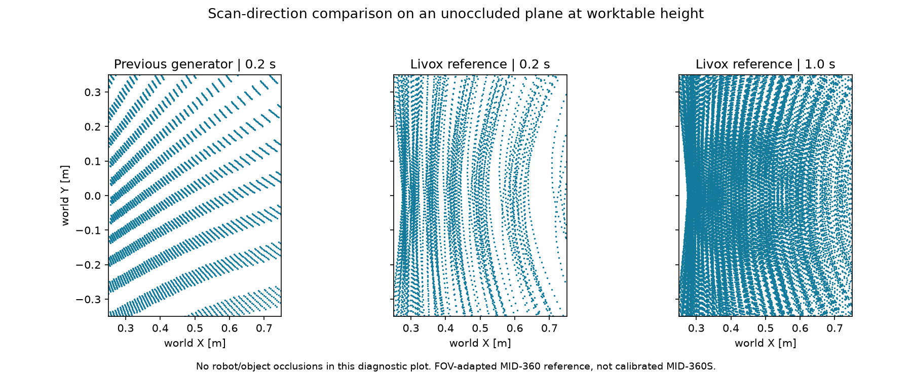

# MID-360S validation (2026-10-18)

Environment: Ubuntu VM, approximately 8 GiB RAM, CPU/software rendering.

- Existing regression suite: 45 tests passed; Python/shell syntax and `git diff --check` passed.
- Both generated models: joint/mocap layout unchanged by sensor asset filtering; ideal ray intersections match the original model for empty, box, and box+bottle scenes.
- Both models: sampled chest RGB/depth rays show no obstruction by the added LiDAR mount (0/2304 per stream).
- Shared renderer: RGB/depth pixels match independent render contexts at chest and wrist stream sizes.
- OpenArm 1.0: headless ROS integration passed: cloud fields/TF, table hits, table removal, camera images, object toggle, LiDAR stop/resume.
- OpenArm 2.0: the same integration passed with RViz and MuJoCo windows running, including both wrist camera streams. RViz point cloud rendering was visually verified.
- All five ROS controllers activated in both integration runs.

Limits: final 1.0 integration was run without GUI on this 8 GiB VM. Full simultaneous 1.0 GUI/camera/LiDAR use on larger-memory hardware remains to be checked. Earlier full-GUI builds exceeded this VM's practical memory budget. No real-device accuracy, Livox proprietary scan pattern, intensity/noise, physical mounting calibration, or new grasp planner was validated.

Defaults retain both RViz and MuJoCo windows. LiDAR starts disabled; use the scene panel MID-360S controls. The mount pose is a project-defined fixed position, not a measured robot calibration. No GitHub push was performed.


## CAD fidelity and density correction (2026-10-18)

- Removed destructive visual decimation: retained 111613 original CAD triangles. Close-up MuJoCo renders confirm the dome and cooling fins retain their curved shape. Collision envelopes and mounting TF are unchanged.
- Both model versions compile, retain expected actuator counts and have no initial LiDAR contacts. Sampled chest RGB/depth rays are unobstructed by the sensor (0/2304 in each camera, both models).
- Same-pose local ray check: table returns increase from 108 at 800 rays to 1088 at 8000 and 5448 at 40000, on both robots. Dense clouds contain approximately 19700 returns; missing geometry is not padded with fake points.
- `lidar_density_check.py` passed against real ROS nodes for both versions: dense default, live density changes, invalid-parameter rejection, disable/resume. OpenArm 1.0 used a headless verification container; OpenArm 2.0 had both RViz and MuJoCo windows enabled. This verification choice does not change the launcher's both-window default.
- On this 8GB VM, sampled dense-mode wall-clock rates were approximately 1.5 Hz (v1) and 2.3 Hz (v2), below the configured 5 Hz maximum. Dense raycasting took approximately 583 ms and 397 ms respectively under concurrent simulation load. These are sample measurements, not guaranteed throughput on another PC. No automatic density reduction is applied.
- All 45 existing lightweight unit tests passed. GPU hardware performance and OpenArm 1.0 with all GUI/camera streams simultaneously were not revalidated in this correction.

Run the density test only in a disposable simulation; it changes table and LiDAR state:

```bash
python /workspaces/OpenArm_sim/tests/lidar_density_check.py
```


## Vendor-reference scan correction

The generator now replays the official Livox-SDK MID-360 direction sequence, FOV-adapted to MID-360S. The reference is **not a measured MID-360S trajectory**. No points were interpolated into empty areas, no random directions were added, and RViz decay stays zero.

Both actual OpenArm 1.0 and 2.0 models were compiled and raycast in their initial pose with a visible 0.5 x 0.7 m worktable. Both had the same table/probe results in this setup (the robot meshes did not occlude these test placements). Each row below summarizes 20 consecutive 0.2-second windows at 40000 attempted rays/window. Small-object tests use opaque 10/20/40 mm cubes at 25 positions (x=0.30..0.66 m, y=-0.25..0.25 m). Every top-center line of sight was independently checked; all placements were visible.

| Measurement, both robot versions | Previous generator | Vendor-reference approximation |
|---|---:|---:|
| Mean worktable 1 cm bin coverage, 0.2 s | 44.29% | 69.84% |
| Minimum worktable coverage, 0.2 s | 43.71% | 65.63% |
| Mean worktable coverage, 1 s | 99.37% | 96.97% |
| 10 mm cubes: zero-return cases, 0.2 s | 193/500 | 17/500 |
| 20 mm cubes: zero-return cases, 0.2 s | 51/500 | 1/500 |
| 40 mm cubes: zero-return cases, 0.2 s | 0/500 | 0/500 |
| All cube sizes: zero-return cases, 1 s | 0/1500 | 0/1500 |

The new reference improves short-window coverage and greatly reduces the observed small-cube misses. It does **not** improve every metric: the previous synthetic generator covered slightly more table bins after 1 second. We preserve the vendor trajectory instead of modifying its distribution to force a perfect coverage score. A single short scan can still miss a small object. In these static tests, every cube had at least six returns over one second with the new reference; this is not a general detection guarantee.

The one-second results combine five consecutive source windows in a **static test**. They are not stale-point accumulation in the ROS output and do not promise one wall-clock second of coverage on a slow machine that skips snapshots. Phase trials overlap and are not independent random trials. The opaque-wall test returned no points on any hidden probe. Exact machine-readable results: [OpenArm 1.0](lidar_pattern_v1.json), [OpenArm 2.0](lidar_pattern_v2.json).

`lidar_pattern_check.py` verifies data hash, coordinate convention, FOV, sequence continuity and wrap, deterministic thinning and simulation-time phase. Hardware noise, reflectivity, beam divergence, actual MID-360S trajectory, motion distortion and grasp success remain unvalidated.

Diagnostic plot (unoccluded plane at the same worktable height; separate from the full-robot tests):




Docker/ROS integration passed for both OpenArm versions after this scan change: bundled-asset loading, high-density default, 800/8000/40000 live profile changes, exact source-index correspondence to simulation time, invalid parameter rejection and stop/resume. Version 1 was tested headless; version 2 had both RViz and MuJoCo windows running. All five controllers became active. The 45 existing unit tests passed. The reference asset was regenerated from the pinned CSV and its SHA-256 matched the bundled file. Camera and robot-control code were not modified in this scan correction.
